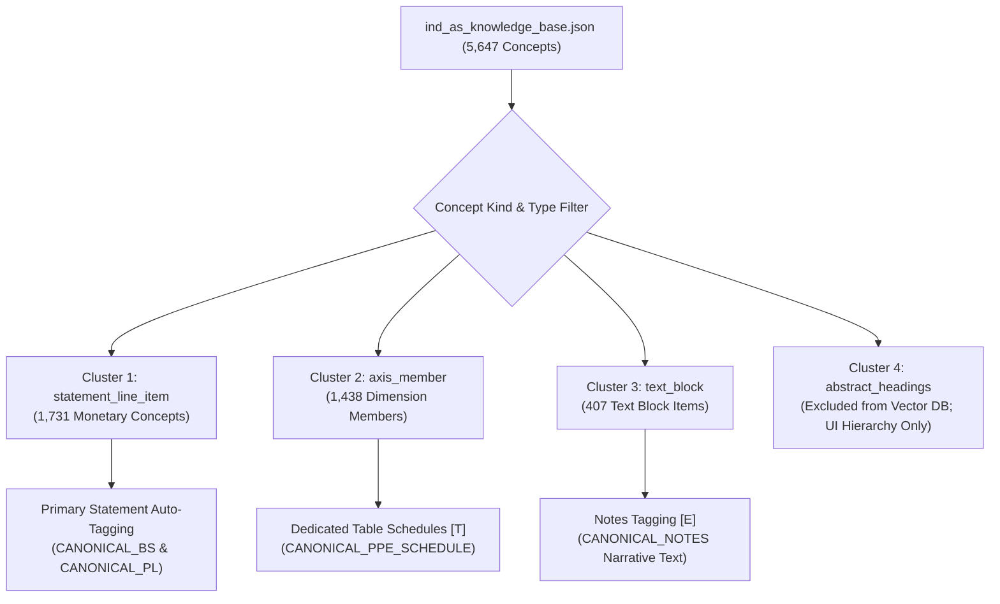
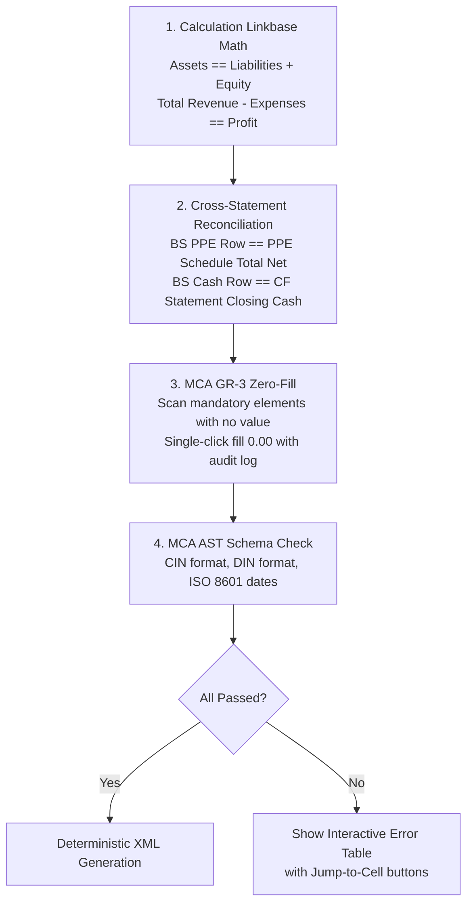

# Canonical Pipeline & Tagging Architecture (End-to-End Specification)

This document specifies the complete end-to-end architecture of **XBRL Autopilot**. It details the **Standard Canonical File schemas**, desktop project workspace layout, vector retrieval clustering, primary statement auto-tagging, dedicated table tagging (`[T]`), narrative notes tagging (`[E]`), in-app validation with zero-fill, and deterministic MCA AOC-4 XBRL XML generation.

---

## 1. The Standard Canonical File Philosophy

Client financial workbooks vary wildly in structure, formatting, and organization. Rather than coupling downstream AI logic to messy Excel files, **XBRL Autopilot strictly decouples extraction from downstream processing**:

```
Messy Client Files (.xlsx, .xls, .pdf) 
            │
            ▼ (Normalizer / CA Preparation)
┌────────────────────────────────────────────────────────────────────────┐
│                   STANDARD CANONICAL FILES (Clean & Viewable)           │
│  1. CANONICAL_BS.xlsx / .csv      (Balance Sheet)                      │
│  2. CANONICAL_PL.xlsx / .csv      (Profit & Loss Statement)            │
│  3. CANONICAL_CF.xlsx / .csv      (Cash Flow Statement)                │
│  4. CANONICAL_SOCIE.xlsx / .csv   (Statement of Changes in Equity)     │
│  5. CANONICAL_PPE_SCHEDULE.xlsx   (Fixed Assets Table Schedule [T])    │
│  6. CANONICAL_NOTES.json / .md    (Notes to Accounts [E])              │
│  7. COMPANY_MASTER.json           (Master Tab Form Details)            │
└────────────────────────────────────────────────────────────────────────┘
            │
            ▼
┌────────────────────────────────────────────────────────────────────────┐
│                   DOWNSTREAM AUTOMATION PIPELINE                       │
│  • Vector DB (ChromaDB / Qdrant) Clustered Retrieval                   │
│  • Primary Statement Line-Item Auto-Tagger (Breadcrumb AI)             │
│  • Table Schedule Tagging [T] (Dimensional Axis/Members & Diff = 0)    │
│  • Notes Tagging [E] (Semantic Chunking & TextBlock Match)             │
│  • In-App Calculation Tree Validation & GR-3 Zero-Fill                 │
│  • Deterministic MCA AOC-4 XBRL XML Generator                          │
└────────────────────────────────────────────────────────────────────────┘
```

Once the 7 standard canonical files exist, **100% of the downstream pipeline is deterministic, robust, and zero-hallucination**.

---

## 2. Standard Canonical File Specifications & Sample Datasets

### 2.1 Standard File 1: `CANONICAL_BS.csv` / `.xlsx` (Balance Sheet)
This file stores the clean, hierarchical Balance Sheet.

#### Schema
| Column Name | Data Type | Description | Example |
| :--- | :--- | :--- | :--- |
| `Row_Index` | `int` | Sequential row number from statement | `11` |
| `Line_Item` | `string` | Human-readable account label | `Property, Plant & Equipment` |
| `Breadcrumb_Hierarchy` | `string` | Full upward parent path separated by ` > ` | `ASSETS > NON-CURRENT ASSETS > Property, Plant & Equipment` |
| `Note_No` | `string` | Normalized note cross-reference | `5` |
| `Current_Year_Amount` | `float` | Amount for Current Reporting Year | `14500000.00` |
| `Previous_Year_Amount`| `float` | Amount for Previous Reporting Year | `12000000.00` |

#### Concrete Sample Dataset
```csv
Row_Index,Line_Item,Breadcrumb_Hierarchy,Note_No,Current_Year_Amount,Previous_Year_Amount
1,Property, Plant & Equipment,ASSETS > Non-current assets > Property, Plant & Equipment,5,14500000.00,12000000.00
2,Capital work-in-progress,ASSETS > Non-current assets > Capital work-in-progress,5,500000.00,0.00
3,Other intangible assets,ASSETS > Non-current assets > Other intangible assets,6,1200000.00,800000.00
4,Non-current financial investments,ASSETS > Non-current assets > Financial Assets > Investments,7,3500000.00,3500000.00
5,Other non-current assets,ASSETS > Non-current assets > Other non-current assets,8,450000.00,320000.00
6,Inventories,ASSETS > Current assets > Inventories,9,8200000.00,6500000.00
7,Trade receivables,ASSETS > Current assets > Financial Assets > Trade receivables,10,12400000.00,9800000.00
8,Cash and cash equivalents,ASSETS > Current assets > Financial Assets > Cash and cash equivalents,11,4100000.00,2300000.00
9,Other current assets,ASSETS > Current assets > Other current assets,12,650000.00,450000.00
10,Total Assets,ASSETS > Total Assets,,44800000.00,35670000.00
11,Equity share capital,EQUITY AND LIABILITIES > Equity > Equity share capital,13,10000000.00,10000000.00
12,Other equity,EQUITY AND LIABILITIES > Equity > Other equity,14,18500000.00,13270000.00
13,Long-term borrowings,EQUITY AND LIABILITIES > Non-current liabilities > Financial Liabilities > Borrowings,15,6000000.00,5000000.00
14,Long-term provisions,EQUITY AND LIABILITIES > Non-current liabilities > Provisions,16,800000.00,600000.00
15,Short-term borrowings,EQUITY AND LIABILITIES > Current liabilities > Financial Liabilities > Borrowings,17,2500000.00,1800000.00
16,Trade payables,EQUITY AND LIABILITIES > Current liabilities > Financial Liabilities > Trade payables,18,5500000.00,4000000.00
17,Other current liabilities,EQUITY AND LIABILITIES > Current liabilities > Other current liabilities,19,1200000.00,800000.00
18,Short-term provisions,EQUITY AND LIABILITIES > Current liabilities > Provisions,20,300000.00,200000.00
19,Total Equity and Liabilities,EQUITY AND LIABILITIES > Total Equity and Liabilities,,44800000.00,35670000.00
```

---

### 2.2 Standard File 2: `CANONICAL_PL.csv` / `.xlsx` (Profit & Loss Statement)
This file stores the clean Statement of Profit and Loss.

#### Schema
Identical to `CANONICAL_BS.csv`: `Row_Index`, `Line_Item`, `Breadcrumb_Hierarchy`, `Note_No`, `Current_Year_Amount`, `Previous_Year_Amount`.

#### Concrete Sample Dataset
```csv
Row_Index,Line_Item,Breadcrumb_Hierarchy,Note_No,Current_Year_Amount,Previous_Year_Amount
1,Revenue from operations,Income > Revenue from operations,21,52000000.00,41000000.00
2,Other income,Income > Other income,22,1200000.00,850000.00
3,Total Income,Income > Total Income,,53200000.00,41850000.00
4,Cost of materials consumed,Expenses > Cost of materials consumed,23,24000000.00,19500000.00
5,Changes in inventories,Expenses > Changes in inventories of finished goods,24,-1500000.00,-800000.00
6,Employee benefits expense,Expenses > Employee benefits expense,25,8500000.00,6800000.00
7,Finance costs,Expenses > Finance costs,26,950000.00,820000.00
8,Depreciation and amortization expense,Expenses > Depreciation and amortization expense,27,2100000.00,1800000.00
9,Other expenses,Expenses > Other expenses,28,11450000.00,9200000.00
10,Total Expenses,Expenses > Total Expenses,,45500000.00,37320000.00
11,Profit before exceptional items and tax,Expenses > Profit before exceptional items and tax,,7700000.00,4530000.00
12,Tax expense: Current tax,Tax Expense > Current tax,29,1950000.00,1150000.00
13,Tax expense: Deferred tax,Tax Expense > Deferred tax,29,520000.00,380000.00
14,Profit for the period,Profit for the period,,5230000.00,3000000.00
```

---

### 2.3 Standard File 3: `CANONICAL_PPE_SCHEDULE.csv` / `.xlsx` (Fixed Assets Table Schedule `[T]`)
This file represents the detailed Fixed Assets Roll-forward grid matching **MCA ELR 400600 (`[400600] Disclosures - Property, plant and equipment`)**.

#### Schema
| Column Name | Type | Description |
| :--- | :--- | :--- |
| `Asset_Class` | `string` | Name of PPE class (e.g., Furniture, Computers, Buildings) |
| `Gross_Opening` | `float` | Gross block balance at beginning of current period |
| `Gross_Additions` | `float` | Additions during the year |
| `Gross_Disposals` | `float` | Deductions/disposals during the year |
| `Gross_Closing` | `float` | Gross block balance at end of period (`Opening + Additions - Disposals`) |
| `Dep_Opening` | `float` | Accumulated depreciation at beginning of period |
| `Dep_For_Year` | `float` | Depreciation expense charged during the year |
| `Dep_Disposals` | `float` | Depreciation reversed on disposed assets |
| `Dep_Closing` | `float` | Accumulated depreciation at end of period (`Opening + For_Year - Disposals`) |
| `Net_Current_Year`| `float` | Net carrying amount at period end (`Gross_Closing - Dep_Closing`) |
| `Net_Previous_Year`| `float` | Net carrying amount at prior period end |

#### Concrete Sample Dataset
```csv
Asset_Class,Gross_Opening,Gross_Additions,Gross_Disposals,Gross_Closing,Dep_Opening,Dep_For_Year,Dep_Disposals,Dep_Closing,Net_Current_Year,Net_Previous_Year
Plant and Equipment,10000000.00,2500000.00,0.00,12500000.00,2000000.00,1000000.00,0.00,3000000.00,9500000.00,8000000.00
Furniture and Fixtures,2000000.00,500000.00,0.00,2500000.00,600000.00,250000.00,0.00,850000.00,1650000.00,1400000.00
Computer Equipment,3000000.00,1200000.00,200000.00,4000000.00,1500000.00,700000.00,150000.00,2050000.00,1950000.00,1500000.00
Office Equipment,1500000.00,300000.00,0.00,1800000.00,400000.00,150000.00,0.00,550000.00,1250000.00,1100000.00
Vehicles,1000000.00,0.00,500000.00,500000.00,400000.00,50000.00,300000.00,150000.00,350000.00,600000.00
Total,17500000.00,4500000.00,700000.00,21300000.00,4900000.00,2150000.00,450000.00,6600000.00,14700000.00,12600000.00
```

---

### 2.4 Standard File 4: `CANONICAL_NOTES.json` (Narrative Disclosures `[E]`)
Stores all narrative text notes and accounting policies.

#### Concrete Sample Structure
```json
{
  "notes": [
    {
      "note_no": "1",
      "title": "Corporate Information and Overview",
      "text_content": "Helmier Private Limited is a private company domiciled in India, incorporated under the provisions of the Companies Act, 2013. The company is primarily engaged in pharmaceutical manufacturing and healthcare services.",
      "proposed_concept": "ind-as:CorporateAndGeneralInformationExplanatory"
    },
    {
      "note_no": "2",
      "title": "Significant Accounting Policies",
      "text_content": "The financial statements have been prepared in accordance with Indian Accounting Standards (Ind AS) notified under Section 133 of the Companies Act, 2013 read with the Companies (Indian Accounting Standards) Rules, 2015. Historical cost convention is followed except for certain financial instruments measured at fair value.",
      "proposed_concept": "ind-as:DescriptionOfAccountingPolicyForBasisOfPreparationOfFinancialStatementsTextBlock"
    },
    {
      "note_no": "2.1",
      "title": "Property, Plant and Equipment Policy",
      "text_content": "Property, plant and equipment are stated at cost, net of accumulated depreciation and accumulated impairment losses, if any. Depreciation is recognized using the straight-line method over estimated useful lives specified in Schedule II of the Companies Act, 2013.",
      "proposed_concept": "ind-as:DescriptionOfAccountingPolicyForPropertyPlantAndEquipmentTextBlock"
    },
    {
      "note_no": "2.2",
      "title": "Revenue Recognition Policy",
      "text_content": "Revenue from contracts with customers is recognized upon transfer of control of promised goods or services to customers in an amount that reflects the consideration the Company expects to receive in exchange for those goods or services.",
      "proposed_concept": "ind-as:DescriptionOfAccountingPolicyForRevenueRecognitionTextBlock"
    },
    {
      "note_no": "30",
      "title": "Related Party Disclosures",
      "text_content": "Key Management Personnel: Directors Mr. John Doe (DIN 01234567) and Mrs. Jane Doe (DIN 07654321). Remuneration paid during the year: Rs. 36,00,000 (PY: Rs. 30,00,000).",
      "proposed_concept": "ind-as:DisclosureOfRelatedPartyExplanatory"
    }
  ]
}
```

---

### 2.5 Standard File 5: `COMPANY_MASTER.json` (Master Tab Form Data)
Stores structured company profile, directors, and auditors details (typed by CA or fetched via MCA).

#### Concrete Sample Structure
```json
{
  "company_profile": {
    "cin": "U85100MH2021PTC366828",
    "company_name": "HELMIER PRIVATE LIMITED",
    "pan": "AAACH1234K",
    "registered_office_address": "Plot 45, MIDC Industrial Area, Andheri East, Mumbai, Maharashtra 400093",
    "nature_of_financial_statements": "Standalone",
    "period_current_start": "2025-04-01",
    "period_current_end": "2026-03-31",
    "period_previous_start": "2024-04-01",
    "period_previous_end": "2025-03-31",
    "reporting_unit": "INR",
    "rounding_level": "Exact"
  },
  "directors": [
    {
      "din": "01234567",
      "name": "John Doe",
      "designation": "Managing Director",
      "category": "Executive",
      "pan": "ABCDE1234F",
      "appointment_date": "2021-08-15"
    },
    {
      "din": "07654321",
      "name": "Jane Doe",
      "designation": "Director",
      "category": "Non-Executive",
      "pan": "VWXYZ5678G",
      "appointment_date": "2021-08-15"
    }
  ],
  "auditors": [
    {
      "auditor_type": "Firm",
      "frn": "123456W",
      "firm_name": "Sharma & Associates LLP",
      "signing_partner_name": "Rajesh Sharma",
      "membership_number": "098765",
      "partner_pan": "PQRST9876H",
      "audit_report_date": "2026-09-02",
      "opinion_type": "Unmodified"
    }
  ]
}
```

---

## 3. Desktop Application Project Storage Layout

The desktop application reserves a local directory to manage multi-company projects:

```
~/.xbrl_autopilot/projects/
├── U85100MH2021PTC366828_FY26/                 # Project Root (CIN + FY)
│   ├── config.json                             # Project metadata, last modified timestamp
│   ├── raw/                                    # Original client files uploaded
│   │   ├── Financials_Final.xlsx
│   │   └── Audit_Report_Signed.pdf
│   ├── canonical/                              # Standard Canonical Files
│   │   ├── CANONICAL_BS.csv
│   │   ├── CANONICAL_PL.csv
│   │   ├── CANONICAL_CF.csv
│   │   ├── CANONICAL_SOCIE.csv
│   │   ├── CANONICAL_PPE_SCHEDULE.csv
│   │   ├── CANONICAL_NOTES.json
│   │   └── COMPANY_MASTER.json
│   ├── mappings/                               # Tagging State & Overrides
│   │   ├── bs_tag_mapping.json
│   │   ├── pl_tag_mapping.json
│   │   ├── ppe_table_mapping.json
│   │   └── notes_tag_mapping.json
│   ├── validation/                             # In-App Validation Reports
│   │   ├── calculation_tree_report.json
│   │   ├── zero_fill_audit.json
│   │   └── mca_precheck_status.json
│   └── output/                                 # Final Generated XBRL Files
│       ├── U85100MH2021PTC366828_AOC4_XBRL.xml
│       └── Validation_Pass_Certificate.pdf
```

---

## 4. Vector Database Setup & Partitioned Clustering

Using [`knowledge_base/ind_as_knowledge_base.json`](file:///home/vanshsharma/projects/xbrl_autopilot/knowledge_base/ind_as_knowledge_base.json) (5,647 concepts), concepts are strictly partitioned into distinct collections/clusters in local ChromaDB to avoid search pollution:



### Partitioning Rules:
1. **Cluster 1 (`statement_line_item`)**:
   - `data_type == "xbrli:monetaryItemType"`
   - `is_abstract == false`
   - `period_type` is `"instant"` (for BS) or `"duration"` (for PL)
   - *Result:* Zero abstract headings or member concepts pollute statement line-item tagging.
2. **Cluster 2 (`axis_member`)**:
   - `data_type == "nonnum:domainItemType"`
   - Concept name ends with `Member` (e.g., `FurnitureAndFixturesMember`, `ComputerEquipmentMember`).
   - *Result:* Used exclusively for table schedule asset class mapping.
3. **Cluster 3 (`text_block`)**:
   - `data_type == "xbrli:stringItemType"` or ends with `TextBlock` / `Explanatory`.
   - *Result:* Used exclusively for Notes tagging.

---

## 5. End-to-End Pipeline Execution

### Phase 1: Primary Statement Auto-Tagging Engine (BS & PL)

For each row in `CANONICAL_BS` or `CANONICAL_PL`:
1. **Query Construction:** Combine `Breadcrumb_Hierarchy` + `Line_Item`:
   ```
   Query: "EQUITY AND LIABILITIES > Shareholder’s funds > Share capital"
   ```
2. **Vector Query:** Embed query using `sentence-transformers/all-MiniLM-L6-v2` and search against **Cluster 1** (`statement_line_item`):
   - Retrieve top 3 candidate concepts.
3. **Balance Compatibility Filter:**
   - For Balance Sheet rows under `EQUITY AND LIABILITIES`: verify `balance == "credit"`.
   - For Balance Sheet rows under `ASSETS`: verify `balance == "debit"`.
4. **Scoring & Output:**
   - **Score $\ge 0.88$:** High confidence $\rightarrow$ Auto-applied.
   - **Score $0.70 - 0.88$:** Medium confidence $\rightarrow$ Pre-selected with amber indicator; user can pick alternatives from dropdown.
   - **Score $< 0.70$:** Low confidence $\rightarrow$ Flagged red for user review.

---

### Phase 2: Dedicated Table Schedule Tagging (`[T]`)

Using `CANONICAL_PPE_SCHEDULE`:
1. **Member Mapping (Row dimension):**
   - Each `Asset_Class` string (e.g., `"Furniture and Fixtures"`) is queried against **Cluster 2** (`axis_member`).
   - `"Furniture and Fixtures"` $\rightarrow$ `ind-as:FurnitureAndFixturesMember`
   - `"Computer Equipment"` $\rightarrow$ `ind-as:ComputerEquipmentMember`
   - `"Plant and Equipment"` $\rightarrow$ `ind-as:PlantAndEquipmentMember`
2. **Column Mapping (Metric dimension):**
   - `Gross_Opening` $\rightarrow$ `ind-as:GrossCarryingAmount` (Context: Beginning of period)
   - `Gross_Additions` $\rightarrow$ `ind-as:AdditionsOtherThanThroughBusinessCombinationsPropertyPlantAndEquipment`
   - `Gross_Disposals` $\rightarrow$ `ind-as:DisposalsPropertyPlantAndEquipment`
   - `Gross_Closing` $\rightarrow$ `ind-as:GrossCarryingAmount` (Context: End of period)
   - `Dep_Opening` $\rightarrow$ `ind-as:AccumulatedDepreciationAndImpairment` (Context: Beginning of period)
   - `Dep_For_Year` $\rightarrow$ `ind-as:DepreciationPropertyPlantAndEquipment`
   - `Dep_Closing` $\rightarrow$ `ind-as:AccumulatedDepreciationAndImpairment` (Context: End of period)
   - `Net_Current_Year` $\rightarrow$ `ind-as:PropertyPlantAndEquipment` (Context: End of period)
3. **Live Difference Reconciliation Algorithm:**
   ```python
   # Mathematical verification before permitting XML generation:
   calc_gross_closing = row["Gross_Opening"] + row["Gross_Additions"] - row["Gross_Disposals"]
   calc_dep_closing = row["Dep_Opening"] + row["Dep_For_Year"] - row["Dep_Disposals"]
   calc_net = calc_gross_closing - calc_dep_closing
   
   diff = calc_net - row["Net_Current_Year"]
   assert abs(diff) < 0.01, f"Difference Error on {row['Asset_Class']}: Difference is {diff}"
   ```
   If `diff != 0`, the UI highlights the cell in red with a live discrepancy explanation.

---

### Phase 3: Notes Tagging Engine (`[E]`) with LLM

For each note in `CANONICAL_NOTES`:
1. **Semantic Chunking:** Narrative text is chunked if it contains multiple sub-policies.
2. **Vector Retrieval:** Query against **Cluster 3** (`text_block`).
3. **LLM Verification (Groq / Llama-3.3):**
   Prompt sends the Note text and the top 3 candidate concepts. LLM selects the exact matching MCA concept:
   ```json
   {
     "note_no": "2.1",
     "selected_concept": "ind-as:DescriptionOfAccountingPolicyForPropertyPlantAndEquipmentTextBlock",
     "confidence": 0.96
   }
   ```
4. **HTML Escaping:** Wrap narrative text in valid XHTML:
   ```xml
   <ind-as:DescriptionOfAccountingPolicyForPropertyPlantAndEquipmentTextBlock contextRef="FY2026_Duration">
     &lt;p&gt;Property, plant and equipment are stated at cost...&lt;/p&gt;
   </ind-as:DescriptionOfAccountingPolicyForPropertyPlantAndEquipmentTextBlock>
   ```

---

### Phase 4: In-App Validation & GR-3 Zero-Fill Engine

Before XML generation, the engine runs 4 validation checks:



#### MCA GR-3 Zero-Fill Mechanism:
MCA Rule GR-3 requires that reportable line items cannot be left empty if they exist in the presentation linkbase.
- The engine identifies all mandatory elements where client value is `null`.
- A prominent button: **"Auto-Fill Mandatory Unreported Lines with 0.00 (GR-3 Compliance)"**.
- Once clicked, empty mandatory fields are populated with `0.00`, and a record is logged in `validation/zero_fill_audit.json`.

---

### Phase 5: Deterministic MCA AOC-4 XBRL XML Generator

The generator combines all modular files into the final XML instance:

```xml
<?xml version="1.0" encoding="UTF-8"?>
<xbrli:xbrl 
  xmlns:in-ca="http://www.mca.gov.in/XBRL/2017/04/in-ca"
  xmlns:ind-as="http://www.mca.gov.in/XBRL/2017/04/ind-as"
  xmlns:xbrli="http://www.xbrl.org/2003/instance"
  xmlns:xbrldi="http://xbrl.org/2006/xbrldi"
  xmlns:xlink="http://www.w3.org/1999/xlink"
  xmlns:iso4217="http://www.xbrl.org/2003/iso4217">

  <link:schemaRef xlink:type="simple" xlink:href="http://www.mca.gov.in/XBRL/2017/04/ind-as/ind-as-2017-04-01.xsd"/>

  <!-- ================= Contexts ================= -->
  <!-- Context 1: Current Year Instant -->
  <xbrli:context id="AsAt_2026_03_31">
    <xbrli:entity>
      <xbrli:identifier scheme="http://www.mca.gov.in/CIN">U85100MH2021PTC366828</xbrli:identifier>
    </xbrli:entity>
    <xbrli:period>
      <xbrli:instant>2026-03-31</xbrli:instant>
    </xbrli:period>
  </xbrli:context>

  <!-- Context 2: Current Year Duration -->
  <xbrli:context id="Duration_2025_04_01_To_2026_03_31">
    <xbrli:entity>
      <xbrli:identifier scheme="http://www.mca.gov.in/CIN">U85100MH2021PTC366828</xbrli:identifier>
    </xbrli:entity>
    <xbrli:period>
      <xbrli:startDate>2025-04-01</xbrli:startDate>
      <xbrli:endDate>2026-03-31</xbrli:endDate>
    </xbrli:period>
  </xbrli:context>

  <!-- Context 3: Dimension Member Context (PPE Furniture & Fixtures) -->
  <xbrli:context id="AsAt_2026_03_31_FurnitureAndFixturesMember">
    <xbrli:entity>
      <xbrli:identifier scheme="http://www.mca.gov.in/CIN">U85100MH2021PTC366828</xbrli:identifier>
      <xbrli:segment>
        <xbrldi:explicitMember dimension="ind-as:PropertyPlantAndEquipmentAxis">ind-as:FurnitureAndFixturesMember</xbrldi:explicitMember>
      </xbrli:segment>
    </xbrli:entity>
    <xbrli:period>
      <xbrli:instant>2026-03-31</xbrli:instant>
    </xbrli:period>
  </xbrli:context>

  <!-- ================= Units ================= -->
  <xbrli:unit id="INR">
    <xbrli:measure>iso4217:INR</xbrli:measure>
  </xbrli:unit>

  <!-- ================= 1. Company Master Facts ================= -->
  <in-ca:CorporateIdentityNumber contextRef="Duration_2025_04_01_To_2026_03_31">U85100MH2021PTC366828</in-ca:CorporateIdentityNumber>
  <in-ca:NameOfCompany contextRef="Duration_2025_04_01_To_2026_03_31">HELMIER PRIVATE LIMITED</in-ca:NameOfCompany>

  <!-- ================= 2. Balance Sheet Facts ================= -->
  <ind-as:ShareCapital contextRef="AsAt_2026_03_31" unitRef="INR" decimals="2">10000000.00</ind-as:ShareCapital>
  <ind-as:PropertyPlantAndEquipment contextRef="AsAt_2026_03_31" unitRef="INR" decimals="2">14700000.00</ind-as:PropertyPlantAndEquipment>

  <!-- ================= 3. Table Schedule Facts [T] ================= -->
  <ind-as:GrossCarryingAmount contextRef="AsAt_2026_03_31_FurnitureAndFixturesMember" unitRef="INR" decimals="2">2500000.00</ind-as:GrossCarryingAmount>
  <ind-as:PropertyPlantAndEquipment contextRef="AsAt_2026_03_31_FurnitureAndFixturesMember" unitRef="INR" decimals="2">1650000.00</ind-as:PropertyPlantAndEquipment>

  <!-- ================= 4. Narrative Notes TextBlock [E] ================= -->
  <ind-as:DescriptionOfAccountingPolicyForPropertyPlantAndEquipmentTextBlock contextRef="Duration_2025_04_01_To_2026_03_31">
    &lt;p&gt;Property, plant and equipment are stated at cost, net of accumulated depreciation...&lt;/p&gt;
  </ind-as:DescriptionOfAccountingPolicyForPropertyPlantAndEquipmentTextBlock>

</xbrli:xbrl>
```

---

## 6. Implementation Readiness Checklist

| Module | Input | Output | Automation Method | Status |
| :--- | :--- | :--- | :--- | :--- |
| **Standard Canonical Files** | Raw Client Files / CA Entry | 6 Standard Sheets (`CANONICAL_BS`, `PL`, `PPE`, `NOTES`, `MASTER`) | Calamine + Pandas | **SPECIFIED** |
| **ChromaDB Vector Clusters** | `ind_as_knowledge_base.json` | 3 Partitioned Collections (`line_item`, `member`, `text_block`) | MiniLM / MPNet Embeddings | **READY** |
| **Primary Statement Tagger** | `CANONICAL_BS.csv`, `CANONICAL_PL.csv` | Tagged Concepts with Confidence Scores | Breadcrumb Vector Cosine Search | **READY** |
| **Table Schedule Tagger [T]** | `CANONICAL_PPE_SCHEDULE.csv` | Dimensional Contexts + Diff = 0 Math Check | Axis/Member Mapping + AST Formula | **READY** |
| **Notes Tagger [E]** | `CANONICAL_NOTES.json` | XHTML Escaped TextBlock Facts | Semantic Chunking + LLM Selection | **READY** |
| **Validation & Zero-Fill** | Tagged Mappings | Pass/Fail Report + Zero-Fill Audit Log | Calculation Trees + GR-3 Fill | **READY** |
| **Final XML Generator** | Tagged State + Master Tab | Official MCA AOC-4 XBRL XML Document | Deterministic Jinja2 / lxml Serializer | **READY** |
