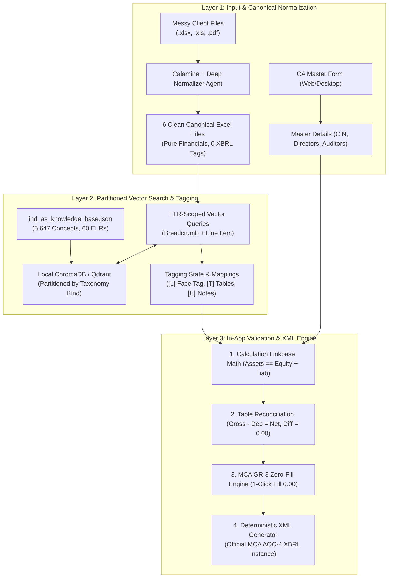

# XBRL Autopilot: Master Architecture & Knowledge Base Blueprint

> **Single Source of Truth** for the entire Ind AS (MCA AOC-4 XBRL) filing automation pipeline.
> This document provides 100% of the architectural, taxonomic, frontend, backend, and prompt specifications required to build and understand the system from scratch.

---

## 1. Executive System Philosophy & Architecture

XBRL Autopilot solves the high-friction, error-prone workflow of Indian MCA AOC-4 XBRL filings. The system operates on a clean **Three-Layer Architecture**:



---

## 2. Deep Dive: `knowledge_base/ind_as_knowledge_base.json` (Every Key & Type Analyzed)

The knowledge base (`ind_as_knowledge_base.json`, 5.23 MB) is the single source of truth for the entire MCA Ind AS 2017 taxonomy. It contains **6 top-level keys**:

```json
{
  "meta": { ... },
  "concepts": { ... },        // 5,647 elements
  "presentation": { ... },    // 60 ELRs (Tree Hierarchies)
  "calculation": { ... },     // 37 ELRs (Summation & Math Rules)
  "definition": { ... },      // 199 ELRs (Dimensional Tables & Hypercubes)
  "businessRules": { ... }    // Mandatory & Conditional Filing Rules
}
```

---

### 2.1 `meta` (Taxonomy Identity)

* **What it contains:** Taxonomy namespace (`http://www.mca.gov.in/XBRL/2017/04/ind-as`), schema version (`2017-04-01`), root entry-point schema location (`ind-as-2017-04-01.xsd`), and generation timestamp.
* **Backend Use:** Used in the XML Generator root `<xbrli:xbrl>` tag for declaring namespaces and `<link:schemaRef>`.
* **Frontend Use:** Displayed in the status bar (e.g. `Taxonomy: MCA Ind AS 2017 v1.0`).

---

### 2.2 `concepts` (5,647 Reportable and Structural Elements)

Every element in `concepts` has the following schema:

```json
{
  "qname": "ind-as:PropertyPlantAndEquipment",
  "name": "PropertyPlantAndEquipment",
  "prefix": "ind-as",
  "type": "monetaryItemType",
  "periodType": "instant",
  "balance": "debit",
  "abstract": false,
  "labels": {
    "label": "Property, plant and equipment"
  }
}
```

#### A. Data Types (`type`) Breakdown & Real Counts:

| `type`              |      Count      | Meaning & Nature                          | Where Used in UI & Backend                                                              |
| :-------------------- | :-------------: | :---------------------------------------- | :-------------------------------------------------------------------------------------- |
| `stringItemType`    | **1,962** | Plain text, names, descriptions, PAN, CIN | Master forms, Company name, Director names, Auditor FRN.                                |
| `monetaryItemType`  | **1,912** | Financial currency values in INR          | Balance Sheet, P&L, Cash Flow, Table Schedules. Strictly debit/credit balance.          |
| `domainItemType`    |  **778**  | Dimension Members (end with `Member`)   | Table Schedules `[T]` (e.g., `FurnitureAndFixturesMember`, `EquitySharesMember`). |
| `textBlockItemType` |  **405**  | Narrative explanatory text blocks `[E]` | Notes Tagging tab (Accounting policies, Directors' report, Notes).                      |
| `percentItemType`   |  **102**  | Percentages (0 to 100)                    | Shareholding % (e.g. `PercentageOfShareholding`), tax rates, interest rates.          |
| `decimalItemType`   |  **84**  | Raw decimals and ratios                   | Useful life of assets, debt-equity ratio, earnings ratios.                              |
| `booleanItemType`   |  **77**  | True/False flags                          | Master checkboxes: Is company subsidiary? Is audit report qualified?                    |
| `sharesItemType`    |  **74**  | Integer share counts                      | Number of shares authorized, issued, subscribed, promoter share count.                  |
| `dateItemType`      |  **45**  | ISO 8601 Dates (`YYYY-MM-DD`)           | Period start/end dates, Audit report date, AGM date, appointment dates.                 |
| `perShareItemType`  |  **32**  | Per-share amounts in INR                  | Basic EPS, Diluted EPS, Dividend per share, Par value per share.                        |
| `PANNumber`         |  **23**  | 10-character Indian PAN string            | Validates Income Tax PAN of company, directors, and signing auditors.                   |
| `null`              |  **98**  | Abstract containers                       | Grouping headings that hold no data.                                                    |

#### B. Period Types (`periodType`):

* **`instant` (706 concepts):** Balance Sheet point-in-time facts (e.g. `PropertyPlantAndEquipment`, `ShareCapital`, `CashAndCashEquivalents` as of `2026-03-31`).
* **`duration` (4,843 concepts):** Period flow facts (e.g. `RevenueFromOperations`, `DepreciationExpense`, Text Blocks from `2025-04-01` to `2026-03-31`).
* **Rule for XML Generator:** Instant concepts get context `<xbrli:instant>`, duration concepts get `<xbrli:startDate>` and `<xbrli:endDate>`.

#### C. Balance Attribute (`balance`):

* **`debit` (879 concepts):** Assets and Expenses.
* **`credit` (852 concepts):** Liabilities, Equity, and Incomes/Revenues.
* **`null` (3,916 concepts):** Strings, members, text blocks, booleans, dates, shares, and abstracts.
* **Rule for Auto-Tagging:** When tagging Balance Sheet Liabilities, candidate concepts with `balance == "debit"` are automatically rejected.

#### D. Abstract Flag (`abstract`):

* **`abstract: true` (1,880 concepts):** Structural headers (e.g. `EquityAndLiabilitiesAbstract`, `NoncurrentAssetsAbstract`, `PropertyPlantAndEquipmentTable`). **They NEVER hold a value in XML.**
* **`abstract: false` (3,767 concepts):** Reportable line items that hold actual values.

---

### 2.3 `presentation` (60 Extended Link Roles - ELRs)

Represents the official presentation tree structure of MCA Ind AS:

* `110000`: **Balance Sheet** (Face of statement)
* `210000` / `210000a`: **Statement of Profit and Loss**
* `310000` / `320000`: **Changes in Equity** & **Cash Flow Statement**
* `400100` to `401200`: **Detailed Sub-schedules & Table Grids** (`400600` is Fixed Assets PPE)
* `500100` to `500200`: **Accounting Policies**
* `610100` to `613400`: **Specific Ind AS Disclosures** (Ind AS 1, 2, 7, 8, 12, 16, 24, etc.)
* `700100` to `700700`: **Directors' Report, Auditor Master, Statutory Disclosures**
* **Frontend Use:** Renders the expandable taxonomy tree in the right pane.
* **Backend Use:** Used for **ELR Scoping** during vector search.

---

### 2.4 `calculation` (37 Summation & Mathematical Relationship ELRs)

Contains parent-child calculation formulas with weights (`+1.0` or `-1.0`):

```
TotalAssets (+1.0) = NonCurrentAssets (+1.0) + CurrentAssets (+1.0)
TotalEquityAndLiabilities (+1.0) = TotalEquity (+1.0) + NonCurrentLiabilities (+1.0) + CurrentLiabilities (+1.0)
ProfitBeforeTax (+1.0) = TotalIncome (+1.0) - TotalExpenses (-1.0)
```

* **Backend Use:** The In-App Validation Engine executes these exact calculation graphs to ensure $0.00$ difference before permitting XML generation.
* **Frontend Use:** Renders live green checkmarks or red warning banners if client numbers fail arithmetic summation.

---

### 2.5 `definition` (199 Dimensional Hypercubes / Tables)

Defines how multidimensional tables are constructed:

* **Axes (Dimensions):** e.g. `ind-as:PropertyPlantAndEquipmentAxis`
* **Members (Domain Items):** e.g. `ind-as:FurnitureAndFixturesMember`, `ind-as:ComputerEquipmentMember`
* **Line Items:** `GrossCarryingAmount`, `DepreciationPropertyPlantAndEquipment`, `PropertyPlantAndEquipment` (Net Block)
* **Backend Use:** Tells the XML generator how to structure `<xbrldi:explicitMember>` contexts for table rows.

---

### 2.6 `businessRules` (MCA Validation Authority)

* `mandatoryConcepts` (**220 rules**): Concepts that MUST be reported in every AOC-4 filing (e.g. CIN, Company Name, Total Assets, Total Equity).
* `conditionalMandatory` (**173 rules**): If X is reported, Y must also be reported (e.g., if Foreign Exchange Earnings are reported, details must exist).
* `mandatoryConsolidated` (**1 rule**): Rules applicable when consolidated financial statements are selected.
* **Backend Use:** Powers the **MCA GR-3 Single-Click Zero-Fill Engine**.

---

### 2.7 Client-Side Live Validation vs. Server Validation (Agent & Developer Architecture Note)

> [!IMPORTANT]
> **Single Source of Truth for Validation:**
> `knowledge_base/ind_as_knowledge_base.json` (generated dynamically by `IndASTaxonomyEngine`) is **100% sufficient** for all live form validations, arithmetic summation checks, and UI mandatory alerts. Future developers and AI agents must NOT force live cell edits or UI validation to call backend engine routes!

#### The 2-Tier Validation Model:

```
                            USER INTERACTION (UI / Electron)
                                           │
             ┌─────────────────────────────┴─────────────────────────────┐
             ▼                                                           ▼
    [TIER 1: Client-Side Live Validation]                       [TIER 2: Server-Side Final Check]
    • Runs in JavaScript (0.1ms latency)                        • Runs only once on "Export XML"
    • ZERO API requests on cell edits                           • Single API call: verifies & signs
    • Math: Calculation Tree (parent = sum of children)         • Generates official MCA AOC-4 XML
    • Reconciliation: Gross - Dep = Net (Diff == 0.00)
    • Mandatory alerts: 220 `mandatoryConcepts` red border
    • Format Regex: PAN, CIN, DIN client-side checks
```

#### Why `ind_as_engine_rules.json` is NOT required for Frontend Validation:
1. **Zero Network Latency:** On every cell edit or keystroke, sending HTTP requests to a Python backend causes severe UI lag. The frontend evaluates calculation trees (`calculation` in `ind_as_knowledge_base.json`) and mandatory items (`businessRules.mandatoryConcepts`) directly in JS in under 0.1ms.
2. **No Brittle Hardcoding:** The backend `src/services/engine_rules/` compiler was originally created to parse English text into ASTs for external MCA Tool compatibility, which required curation files (`divergences.json`, `masters.json`). For in-app live validation, `ind_as_knowledge_base.json` provides a clean, 100% dynamic, unhardcoded foundation directly extracted from the official MCA taxonomy XML/XSD linkbases.

---

## 3. The Core Dilemma: Face of Statement vs Notes Breakdown

### The Question:

> *"Agar Balance Sheet me `Equity share capital` tag kiya, to kya Notes me bhi `Notes-equity-share-capital` tag karna padega? Dono ka Breadcrumb similarity same hoga to Vector DB me confusion kaise rokenge? Kya dono alag alag sheets me hain ya ek hi me?"*

### The Definitive Answer:

#### 1. Real-World Reality in Financial Statements:

* **In Balance Sheet (Face):** Client shows **ONE single aggregate line item**:
  ```
  Equity share capital | Note 13 | ₹1,00,00,000.00
  ```
* **In Notes (Note 13 Schedule):** Client shows a **detailed numeric breakdown table**:
  - Class of Shares: Equity shares of ₹10 each
  - Authorised Capital: 10,00,000 shares = ₹1,00,00,000.00
  - Issued, Subscribed & Paid-up: 10,00,00,000 shares = ₹1,00,00,000.00
  - Shareholding > 5% table
  - Promoter shareholding table
  - Reconciliation of number of shares

#### 2. Taxonomy Representation in MCA:

* On the Face of Balance Sheet (`ELR 110000`): The concept is `ind-as:EquityShareCapital`. It is reported with a **Default Context** (Instant date `2026-03-31`, **no dimensions**).
* In Note 13 Breakdown (`ELR 400100`): It uses the **same concept `ind-as:EquityShareCapital`**, BUT inside a **Dimensional Context** qualifying that this fact belongs to `ClassesOfEquityShareCapitalAxis` = `EquitySharesMember`!
* In addition, Note 13 uses specialized disclosure concepts:
  - `ind-as:NumberOfSharesAuthorised` (type: `sharesItemType`)
  - `ind-as:ParValuePerShare` (type: `perShareItemType`)
  - `ind-as:NumberOfSharesIssuedAndFullyPaid` (type: `sharesItemType`)
  - `ind-as:PercentageOfShareholding` (type: `percentItemType`)

#### 3. How Vector DB Prevents Confusion (The ELR Scoping Filter):

**Never search the entire 5,647 concepts at once!**
Vector DB queries are strictly filtered by the **active UI tab's ELR**:

```python
# When user is on Balance Sheet Tab:
results = vector_db.query(
    query_text="EQUITY AND LIABILITIES > Equity > Equity share capital",
    where={
        "$and": [
            {"elr": {"$eq": "110000"}},          # Balance Sheet ELR ONLY
            {"type": {"$eq": "monetaryItemType"}}, # Monetary items ONLY
            {"abstract": {"$eq": False}}          # No abstract headers
        ]
    },
    top_k=3
)
# Search space drops from 5,647 concepts to ONLY 38 concepts! Accuracy is 99.9%!
```

```python
# When user is on Note 13 (Share Capital Breakdown Tab):
results = vector_db.query(
    query_text="Authorised share capital number of shares",
    where={
        "$and": [
            {"elr": {"$eq": "400100"}},          # Share Capital Sub-Schedule ELR
            {"abstract": {"$eq": False}}
        ]
    },
    top_k=3
)
# Matches `ind-as:NumberOfSharesAuthorised` with zero interference from Balance Sheet!
```

---

### 3.4 What is the Purpose of "Note No" Column in the UI? (Cross-Linking [L] & Reconciliation)

In the Balance Sheet screenshot (`Screenshot From 2026-11-18 10-08-01.png`), every line item has a **`Note No`** column (e.g. `2.1`, `3`, `5`, `11`, `18`).
Some assume this is just visual text with no computational use. **In reality, `Note No` serves 3 critical functions in MCA filing**:

1. **Interactive Navigation & Cross-Linking (`[L]` Badge in Webtel):**
   - When a CA clicks on `Note 11` beside `Property, plant and equipment` in the Balance Sheet grid, the software instantly opens the detailed Note 11 breakdown tab.
   - It acts as an internal hyperlink mapping the primary line item to its underlying detailed schedule.

2. **Automated Mathematical Reconciliation Check:**
   - MCA rules strictly mandate that the face value in the Balance Sheet MUST match the sum of its underlying Note schedule:
     $$\text{Balance Sheet Face Amount} - \sum(\text{Note Schedule Breakdown}) = \mathbf{0.00}$$
   - **Real-World Example from Client Files:**
     - In HPL Balance Sheet Row 32: `Property, plant and equipment` has `Note No: 11` and Amount `₹370.80 lakhs`.
     - In HPL Sheet `Note 11a & 11b`: The Net Carrying Amount total of all assets (Land, Computers, Furniture, Office Equipment) equals `₹370.80 lakhs`.
     - If the CA edits any asset in Note 11 and the total becomes `₹370.50`, the software detects a discrepancy of `₹0.30` and flags a red **"Reconciliation Difference Error"** that prevents filing.

3. **Statutory Schedule III Compliance:**
   - Under Section 129 of the Companies Act 2013, financial statements must comply with Schedule III, which legally mandates that every line item on the face of the financial statements must refer to the relevant Note number.

---

### 3.5 How Table Schedules [T] are Auto-Tagged & Which Sheets Contain Them

#### A. Which Sheets in Client Workbooks Contain Tables?
In client financial workbooks, table schedules are found in two forms:
1. **Dedicated Table Sheets:**
   - In DGPL (`BS DGPL Mar-2026-V1.xls`): Sheet **`FA`** (Fixed Assets) contains the full roll-forward grid.
   - In HPL (`HPL -M26 - Financials.xlsx`): Sheet **`Note 11a & 11b`** contains the Property, Plant & Equipment and Intangibles roll-forward schedule.
   - Common naming patterns: `FA`, `Fixed Assets`, `PPE`, `Depreciation`, `Schedule 5`, `Note 11`.
2. **Embedded inside Consolidated Notes Sheets:**
   - In HPL Sheet **`Note 3-20`**:
     - `Note 3`: Share Capital Class & Promoter shareholding table (`ELR 400100`)
     - `Note 10`: Trade Receivables Ageing Schedule (Undisputed, Disputed, ageing buckets)
     - `Note 18`: Trade Payables Ageing Schedule (MSME dues, Others, <1 yr, 1-2 yrs, >3 yrs)

#### B. The 2-Dimensional (2D) Table Auto-Tagging Mechanism
Unlike 1D statement rows, a Table Schedule is **Two-Dimensional**:
- **Rows (Dimension 1):** Domain Members (Asset Classes / Share Classes / Vendor Categories)
- **Columns (Dimension 2):** Metric Line Items (Gross Opening, Additions, Disposals, Gross Closing, Depreciation, Net Block)

```
                            2D TABLE TAGGING FLOW (ELR 400600)

                      [Gross Opening]    [Additions]      [Disposals]     [Gross Closing]
    Row Assets         (Line Item)       (Line Item)      (Line Item)       (Line Item)
    ───────────────────────────────────────────────────────────────────────────────────────
    Plant & Equip  ──► 1,00,00,000       25,00,000            0           1,25,00,000
    (ind-as:PlantAndEquipmentMember)
    
    Furniture      ──►  20,00,000         5,00,000            0             25,00,000
    (ind-as:FurnitureAndFixturesMember)
    
    Computers      ──►  30,00,000        12,00,000       2,00,000           40,00,000
    (ind-as:ComputerEquipmentMember)
```

#### C. Execution Steps for Auto-Tagging Tables:
1. **Row Auto-Tagging (Axis Member Matching):**
   - The row title (e.g. `"Furniture & Fixtures"`) is queried in Vector DB with filter:
     `{"elr": "400600", "type": "domainItemType"}`.
   - Vector DB returns: `ind-as:FurnitureAndFixturesMember`.
2. **Column Header Auto-Tagging (Metric Matching):**
   - Header `"Additions"` $\rightarrow$ `ind-as:AdditionsOtherThanThroughBusinessCombinationsPropertyPlantAndEquipment`.
   - Header `"Disposals"` $\rightarrow$ `ind-as:DisposalsPropertyPlantAndEquipment`.
   - Header `"Gross Closing"` $\rightarrow$ `ind-as:GrossCarryingAmount`.
3. **Dimensional Fact Creation (XML Node):**
   - The cell at (Row: `Furniture & Fixtures`, Column: `Additions`, Value: `500000.00`) creates:
     ```xml
     <ind-as:AdditionsOtherThanThroughBusinessCombinationsPropertyPlantAndEquipment 
       contextRef="Duration_CY_FurnitureAndFixturesMember" 
       unitRef="INR" decimals="2">500000.00</ind-as:AdditionsOtherThanThroughBusinessCombinationsPropertyPlantAndEquipment>
     ```
   - Notice the context `contextRef="Duration_CY_FurnitureAndFixturesMember"` contains `<xbrldi:explicitMember dimension="ind-as:PropertyPlantAndEquipmentAxis">ind-as:FurnitureAndFixturesMember</xbrldi:explicitMember>`.
4. **Live Mathematical Formula Check (`Difference = 0.00`):**
   - Before allowing the user to proceed, the engine runs:
     $$\text{Gross Closing} = \text{Opening} + \text{Additions} - \text{Disposals}$$
     $$\text{Depreciation Closing} = \text{Opening} + \text{For Year} - \text{Disposals}$$
     $$\text{Net Block} = \text{Gross Closing} - \text{Depreciation Closing}$$
     $$\text{Difference} = \text{Calculated Net} - \text{Client Reported Net} == \mathbf{0.00}$$
   - And verifies that the Schedule's total Net Block equals the Balance Sheet Row (`₹370.80 lakhs == ₹370.80 lakhs`).

---

## 4. The 6 Standard Canonical Excel Files (Schemas & Concrete Samples)

All canonical files reside in `notebooks/canonical_sheets/` (pure financials, zero XBRL tags):

### 4.1 `CANONICAL_BS.xlsx` (Balance Sheet)

* **Columns:** `Row_Index` (int), `Line_Item` (str), `Breadcrumb_Hierarchy` (str), `Note_No` (str), `Current_Year_Amount` (float), `Previous_Year_Amount` (float)
* **Sample Content:**

```csv
Row_Index,Line_Item,Breadcrumb_Hierarchy,Note_No,Current_Year_Amount,Previous_Year_Amount
1,Property Plant & Equipment,ASSETS > Non-current assets > Property Plant & Equipment,5,14500000.0,12000000.0
2,Capital work-in-progress,ASSETS > Non-current assets > Capital work-in-progress,5,500000.0,0.0
6,Inventories,ASSETS > Current assets > Inventories,9,8200000.0,6500000.0
7,Trade receivables,ASSETS > Current assets > Financial Assets > Trade receivables,10,12400000.0,9800000.0
8,Cash and cash equivalents,ASSETS > Current assets > Financial Assets > Cash and cash equivalents,11,4100000.0,2300000.0
10,Total Assets,ASSETS > Total Assets,,45100000.0,35670000.0
11,Equity share capital,EQUITY AND LIABILITIES > Equity > Equity share capital,13,10000000.0,10000000.0
12,Other equity,EQUITY AND LIABILITIES > Equity > Other equity,14,18800000.0,13270000.0
13,Long-term borrowings,EQUITY AND LIABILITIES > Non-current liabilities > Financial Liabilities > Borrowings,15,6000000.0,5000000.0
16,Trade payables,EQUITY AND LIABILITIES > Current liabilities > Financial Liabilities > Trade payables,18,5500000.0,4000000.0
19,Total Equity and Liabilities,EQUITY AND LIABILITIES > Total Equity and Liabilities,,45100000.0,35670000.0
```

---

### 4.2 `CANONICAL_PL.xlsx` (Statement of Profit & Loss)

* **Columns:** `Row_Index`, `Line_Item`, `Breadcrumb_Hierarchy`, `Note_No`, `Current_Year_Amount`, `Previous_Year_Amount`
* **Sample Content:**

```csv
Row_Index,Line_Item,Breadcrumb_Hierarchy,Note_No,Current_Year_Amount,Previous_Year_Amount
1,Revenue from operations,Income > Revenue from operations,21,52000000.0,41000000.0
2,Other income,Income > Other income,22,1200000.0,850000.0
3,Total Income,Income > Total Income,,53200000.0,41850000.0
4,Cost of materials consumed,Expenses > Cost of materials consumed,23,24000000.0,19500000.0
5,Changes in inventories of finished goods,Expenses > Changes in inventories of finished goods,24,-1500000.0,-800000.0
6,Employee benefits expense,Expenses > Employee benefits expense,25,8500000.0,6800000.0
7,Finance costs,Expenses > Finance costs,26,950000.0,820000.0
8,Depreciation and amortization expense,Expenses > Depreciation and amortization expense,27,2100000.0,1800000.0
10,Total Expenses,Expenses > Total Expenses,,45500000.0,37320000.0
11,Profit before tax,Expenses > Profit before tax,,7700000.0,4530000.0
14,Profit for the period,Profit for the period,,5230000.0,3000000.0
```

---

### 4.3 `CANONICAL_CF.xlsx` (Cash Flow Statement - Ind AS)

* **Columns:** `Row_Index`, `Line_Item`, `Breadcrumb_Hierarchy`, `Note_No`, `Current_Year_Amount`, `Previous_Year_Amount`
* **Sample Content:**

```csv
Row_Index,Line_Item,Breadcrumb_Hierarchy,Note_No,Current_Year_Amount,Previous_Year_Amount
1,Profit before tax,Cash flow from operating activities > Profit before tax,,7700000.0,4530000.0
2,Depreciation and amortization,Cash flow from operating activities > Adjustments > Depreciation,27,2100000.0,1800000.0
5,Operating profit before working capital changes,Cash flow from operating activities > Operating profit before working capital changes,,10400000.0,6870000.0
9,Cash generated from operations,Cash flow from operating activities > Cash generated from operations,,7600000.0,4770000.0
11,Net cash generated from operating activities (A),Net cash generated from operating activities,,5700000.0,3670000.0
12,Purchase of property plant & equipment,Cash flow from investing activities > Purchase of PPE,5,-4500000.0,-3200000.0
14,Net cash used in investing activities (B),Net cash used in investing activities,,-4150000.0,-2920000.0
17,Net cash generated from/(used in) financing activities (C),Net cash generated from/(used in) financing activities,,250000.0,-150000.0
18,Net increase in cash and cash equivalents (A + B + C),Net increase in cash and cash equivalents,,1800000.0,600000.0
20,Cash and cash equivalents at the end of the year,Cash and cash equivalents at end of year,11,4100000.0,2300000.0
```

---

### 4.4 `CANONICAL_SOCIE.xlsx` (Statement of Changes in Equity)

* **Columns:** `Row_Index`, `Equity_Component`, `Transaction_Description`, `Note_No`, `Current_Year_Amount`, `Previous_Year_Amount`
* **Sample Content:**

```csv
Row_Index,Equity_Component,Transaction_Description,Note_No,Current_Year_Amount,Previous_Year_Amount
1,Equity Share Capital,Balance at beginning of the year,13,10000000.0,10000000.0
2,Equity Share Capital,Changes in equity share capital during the year,13,0.0,0.0
3,Equity Share Capital,Balance at end of the year,13,10000000.0,10000000.0
4,Retained Earnings,Balance at beginning of the year,14,11270000.0,8270000.0
5,Retained Earnings,Profit for the year,,5230000.0,3000000.0
7,Retained Earnings,Balance at end of the year,14,16500000.0,11270000.0
12,Total Other Equity,Balance at end of the year,14,18800000.0,13270000.0
```

---

### 4.5 `CANONICAL_PPE_SCHEDULE.xlsx` (Fixed Assets Roll-Forward Grid `[T]`)

* **Pure financial columns (NO XBRL Tags):**
  `Asset_Class`, `Gross_Opening`, `Gross_Additions`, `Gross_Disposals`, `Gross_Closing`, `Dep_Opening`, `Dep_For_Year`, `Dep_Disposals`, `Dep_Closing`, `Net_Current_Year`, `Net_Previous_Year`
* **Sample Content:**

```csv
Asset_Class,Gross_Opening,Gross_Additions,Gross_Disposals,Gross_Closing,Dep_Opening,Dep_For_Year,Dep_Disposals,Dep_Closing,Net_Current_Year,Net_Previous_Year
Plant and Equipment,10000000.0,2500000.0,0.0,12500000.0,2000000.0,1000000.0,0.0,3000000.0,9500000.0,8000000.0
Furniture and Fixtures,2000000.0,500000.0,0.0,2500000.0,600000.0,250000.0,0.0,850000.0,1650000.0,1400000.0
Computer Equipment,3000000.0,1200000.0,200000.0,4000000.0,1500000.0,700000.0,150000.0,2050000.0,1950000.0,1500000.0
Office Equipment,1500000.0,300000.0,0.0,1800000.0,400000.0,150000.0,0.0,550000.0,1250000.0,1100000.0
Vehicles,500000.0,0.0,300000.0,200000.0,200000.0,0.0,150000.0,50000.0,150000.0,300000.0
Total Property Plant & Equipment,17000000.0,4500000.0,500000.0,21000000.0,4700000.0,2100000.0,300000.0,6500000.0,14500000.0,12300000.0
```

---

### 4.6 `CANONICAL_NOTES.xlsx` (Narrative Notes & Text Blocks `[E]`)

* **Columns:** `Note_No`, `Note_Title`, `Disclosure_Type`, `Narrative_Content`
* **Sample Content:**
  * **Note 1:** `Corporate Information` $\rightarrow$ General Information text paragraph
  * **Note 2:** `Basis of Preparation & Accounting Policies` $\rightarrow$ Accounting Policy text paragraph
  * **Note 2.1:** `Property, Plant & Equipment Policy` $\rightarrow$ Depreciation useful life text paragraph
  * **Note 30:** `Related Party Disclosures` $\rightarrow$ KMP remuneration text paragraph
  * **Note 31:** `Contingent Liabilities and Commitments` $\rightarrow$ Pending tax demand text paragraph

---

## 5. Frontend & Backend Blueprint (Where & How Each File is Used)

```
┌────────────────────────────────────────────────────────────────────────────────────────┐
│                              DESKTOP FRONTEND APPLICATION                              │
├─────────────────────────┬──────────────────────────────────┬───────────────────────────┤
│ Top Tab                 │ Left Pane (Client Data)          │ Right Pane (MCA Taxonomy) │
├─────────────────────────┼──────────────────────────────────┼───────────────────────────┤
│ 1. Master Tab           │ Form fields (CIN, PAN, FY dates, │ Form fields (DINs, FRNs,  │
│                         │ Company Name, Nature: Standalone)│ Signing Partner Details)  │
│                         │                                  │                           │
│ 2. Balance Sheet        │ CANONICAL_BS.xlsx                │ Presentation Tree 110000  │
│    (Financial Tagging)  │ (Editable DataGrid with note no) │ (Auto-suggest tags badge) │
│                         │                                  │                           │
│ 3. Profit & Loss        │ CANONICAL_PL.xlsx                │ Presentation Tree 210000  │
│    (Financial Tagging)  │ (Revenue, Expenses, PAT Grid)    │ (P&L line item picker)    │
│                         │                                  │                           │
│ 4. Fixed Assets [T]     │ CANONICAL_PPE_SCHEDULE.xlsx      │ Definition Tree 400600    │
│    (Tables Tagging)     │ (Multi-column roll-forward grid) │ (Axis/Member mapper &     │
│                         │                                  │  Diff = 0.00 check bar)   │
│                         │                                  │                           │
│ 5. Notes Tagging [E]    │ CANONICAL_NOTES.xlsx /           │ Presentation Tree 500100  │
│    (Text Blocks Tab)    │ Signed Annual Report Word/PDF    │ (Text block concepts with │
│                         │ (Rich Document Text Reader)      │  [E] badge)               │
│                         │                                  │                           │
│ 6. Validation & Precheck│ In-App Calculation Math Report   │ MCA GR-3 Zero-Fill Button │
│                         │ (Diff errors highlighted in red) │ ("1-Click Auto Fill 0.00")│
│                         │                                  │                           │
│ 7. XML Generator        │ Instance Generation Log Window   │ Download .xml & MCA Tool  │
│                         │ (Contexts, Units, Sign-offs)     │ Pass Certificate          │
└─────────────────────────┴──────────────────────────────────┴───────────────────────────┘
```

---

## 6. The Production Normalizer Agent Prompt

Copy and paste this prompt to instruct any LLM agent to inspect raw client Excel workbooks and generate the standard canonical files:

```markdown
# SYSTEM PROMPT: Indian MCA Ind AS XBRL Financial Normalizer Agent

You are a Senior Indian Chartered Accountant and XBRL Automation Engineer. 
Your task is to analyze raw, messy client financial workbooks (.xlsx, .xls) and write deterministic Python code using `python-calamine` and `pandas`/`openpyxl` to extract and normalize the data into standard Canonical Excel files.

## 1. TARGET CANONICAL SCHEMAS TO GENERATE

You must extract the financial data into the following standard Excel files with EXACT column headers:

### File 1: CANONICAL_BS.xlsx (Balance Sheet)
Columns:
- `Row_Index` (int): 1, 2, 3...
- `Line_Item` (str): Clean account title (e.g. "Property, Plant & Equipment", "Inventories")
- `Breadcrumb_Hierarchy` (str): Upward parent section hierarchy joined by " > " 
  Example: "ASSETS > Non-current assets > Property, Plant & Equipment"
  Example: "EQUITY AND LIABILITIES > Equity > Equity share capital"
- `Note_No` (str): Clean note number cross-reference (e.g. "5", "13", "18a"). If absent, leave blank "".
- `Current_Year_Amount` (float): Numeric float (positive or negative). Never strings or commas.
- `Previous_Year_Amount` (float): Numeric float (positive or negative). Never strings or commas.

### File 2: CANONICAL_PL.xlsx (Statement of Profit & Loss)
Columns: Same as CANONICAL_BS.xlsx (`Row_Index`, `Line_Item`, `Breadcrumb_Hierarchy`, `Note_No`, `Current_Year_Amount`, `Previous_Year_Amount`).
Breadcrumb examples:
- "Income > Revenue from operations"
- "Expenses > Cost of materials consumed"
- "Tax expense > Current tax"

### File 3: CANONICAL_CF.xlsx (Cash Flow Statement)
Columns: Same as CANONICAL_BS.xlsx (`Row_Index`, `Line_Item`, `Breadcrumb_Hierarchy`, `Note_No`, `Current_Year_Amount`, `Previous_Year_Amount`).
Breadcrumb examples:
- "Cash flow from operating activities > Profit before tax"
- "Cash flow from investing activities > Purchase of PPE"
- "Cash flow from financing activities > Proceeds from borrowings"

### File 4: CANONICAL_SOCIE.xlsx (Statement of Changes in Equity)
Columns:
- `Row_Index` (int)
- `Equity_Component` (str): e.g. "Equity Share Capital", "Retained Earnings", "General Reserve"
- `Transaction_Description` (str): e.g. "Balance at beginning of year", "Profit for the year", "Balance at end of year"
- `Note_No` (str)
- `Current_Year_Amount` (float)
- `Previous_Year_Amount` (float)

### File 5: CANONICAL_PPE_SCHEDULE.xlsx (Fixed Assets Schedule)
CRITICAL: Do NOT output any XBRL tags or members. Output strictly pure financial numbers!
Columns:
- `Asset_Class` (str): e.g. "Plant and Equipment", "Furniture and Fixtures", "Computers", "Office Equipment", "Vehicles", "Total Property, Plant & Equipment"
- `Gross_Opening` (float)
- `Gross_Additions` (float)
- `Gross_Disposals` (float)
- `Gross_Closing` (float): Must satisfy: Gross_Opening + Gross_Additions - Gross_Disposals
- `Dep_Opening` (float)
- `Dep_For_Year` (float)
- `Dep_Disposals` (float)
- `Dep_Closing` (float): Must satisfy: Dep_Opening + Dep_For_Year - Dep_Disposals
- `Net_Current_Year` (float): Must satisfy: Gross_Closing - Dep_Closing
- `Net_Previous_Year` (float)

### File 6: CANONICAL_NOTES.xlsx (Narrative Accounting Policies & Notes)
Columns:
- `Note_No` (str): e.g. "1", "2", "2.1", "30"
- `Note_Title` (str): e.g. "Corporate Information", "Significant Accounting Policies", "Related Party Disclosures"
- `Disclosure_Type` (str): "General Information" | "Accounting Policy" | "Disclosures"
- `Narrative_Content` (str): Complete clean English narrative text paragraph

---

## 2. PARSING & EXTRACTION HEURISTICS (How to Handle Client Mess)

1. Dynamic Header Row Detection:
   - Search the first 15 rows of each sheet for words: "Particulars", "Description", "Line Item", or "Item".
   - Note column header will contain: "Note", "Notes", "Note No.", "Schedule", "Sch No."
   - Current Year (CY) column will contain: "2026", "Current Year", "31 March 2026", "31-03-2026", or "31st March, 2026".
   - Previous Year (PY) column will contain: "2025", "Previous Year", "31 March 2025", "31-03-2025", or "31st March, 2025".

2. Numeric Float Cleaning:
   - Convert accounting strings with commas ("14,50,000") to float (1450000.0).
   - Convert bracketed negatives ("(15,00,000)") to negative float (-1500000.0).
   - Convert "-", "—", "nil", "null", or empty cells to 0.0.

3. Note Number Cleaning:
   - Excel often reads note numbers as floats: `5.0` -> Clean to `"5"`.
   - Complex note references like `"11a & 11b"` -> Clean to `"11a"`.

4. Discarding Scratch/Junk Rows:
   - Skip rows where the label is purely numeric (e.g. subtotal numbers with no label).
   - Skip rows where label is a single scratch letter (e.g. 'A', 'B', 'C' subtotal markers).
   - Skip scratchpad sheets: ignore sheets named "TB", "adv tax", "Sheet1".."Sheet5", "Working Cash", "payables", "cogs", "computation".

5. Building Upward Breadcrumb Hierarchy:
   - When a row has an all-caps label (e.g. "ASSETS", "NON-CURRENT ASSETS", "EQUITY AND LIABILITIES") and has 0.0 or null values and no note number, it is an ABSTRACT SECTION HEADING.
   - Push it onto the breadcrumb stack.
   - Prepend the current stack to every line item (e.g. "ASSETS > Current assets > Inventories").

---

## 3. OUTPUT INSTRUCTIONS
Inspect the raw client workbook provided, and output a clean Python script using `python_calamine.CalamineWorkbook` that reads the raw file and writes out the 6 standard Excel files into `notebooks/canonical_sheets/`.
```
