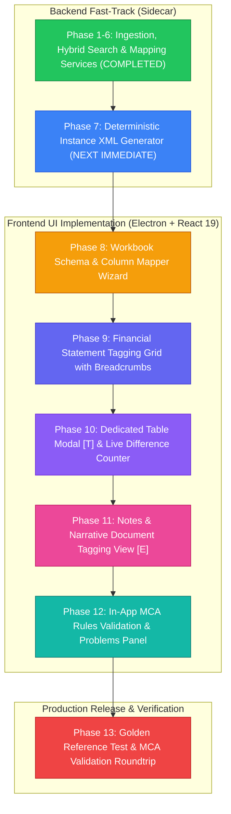

# XBRL Autopilot · Master Phased Roadmap & Implementation Guide

> **Purpose**: This document provides the end-to-end phased roadmap for building the MCA Ind AS 2017 (AOC-4) XBRL Autopilot. It defines the strict chronological order of what gets built, how each phase connects to the next, and contains **deep production-grade code specifications** for every upcoming backend and frontend phase.

---

## 1. High-Level Phased Timeline



---

## 2. Status Matrix

| Phase | Milestone Name | Primary Stack | Key Outputs / Endpoints | Status |
| :---: | :--- | :--- | :--- | :---: |
| **1-3** | **Taxonomy Ingestion & Engine Knowledge Base** | Python, Calamine, ElementTree | `t.py`, `ind_as_knowledge_base.json`, `ind_as_engine_authority.json` (5,647 concepts, 60 ELRs, 199 Tables) | **COMPLETED** |
| **4** | **Hybrid AI Retrieval & FlashRank Reranker** | Qdrant Cloud, BM25, FlashRank | `POST /api/v1/taxonomies/recommend`, `POST /api/v1/mapping/suggest_column` | **COMPLETED** |
| **5** | **Workbook Inspection & Column Detection** | Python-Calamine Rust engine | `POST /api/v1/workbooks/inspect`, `POST /api/v1/workbooks/read` | **COMPLETED** |
| **6** | **Notes `[E]` & Table Block `[T]` Tagging** | Regex chunker, Table reconciler | `POST /api/v1/mapping/notes/suggest`, `POST /api/v1/mapping/tables/suggest` | **COMPLETED** |
| **7** | **Deterministic Instance XML Generator** | Python ElementTree, ISO4217, XBRLI | `POST /api/v1/instances/generate` (Emits valid AOC-4 XML instance) | **NEXT (In Progress)** |
| **8** | **Workbook Schema & Column Mapper UI Wizard** | React 19, Tailwind, Electron IPC | `SchemaMapperModal.tsx` (Pre-classifies BS/PL sheets and selects cols) | **Pending** |
| **9** | **Tagging Grid & Breadcrumb Mapper UI** | Univer Spreadsheet, React 19 | `TaggingGrid.tsx` (Live color tagging, 1-click approve, breadcrumb path) | **Pending** |
| **10** | **Dedicated Table Modal `[T]` UI** | React 19, Zustand | `DedicatedTableModal.tsx` (Show/hide members, schedule reconciliation) | **Pending** |
| **11** | **Notes Document Tagging View `[E]` UI** | React 19, Monaco / ProseMirror | `NotesTaggingView.tsx` (Paragraph blue highlighting, 1-click textblock tag) | **Pending** |
| **12** | **In-App MCA Rules Engine & Problems Panel** | TypeScript in-memory AST engine | `ProblemsPanel.tsx` (1,351 rules evaluated live, locate & fix shortcuts) | **Pending** |
| **13** | **Golden Roundtrip & Packaging** | Python pytest, Electron-Builder | `test_mca_golden_roundtrip.py`, Windows `.exe` / Linux AppImage | **Pending** |

---

## 3. Deep Dive into Implementation Phases

---

### PHASE 7: Deterministic Instance XML Generator (NEXT IMMEDIATE STEP)

* **Objective**: Build the backend service that takes tagged financial statement facts, metadata, and schedule table blocks, and outputs a 100% compliant MCA AOC-4 XBRL XML instance document.
* **Why it must be built now**: This completes the backend lifecycle. With this route in place, the entire backend pipeline (from raw Excel $\rightarrow$ AI Tagging $\rightarrow$ Final Valid XML) is 100% complete and verified by automated pytests before starting frontend UI work.

#### Architecture & Rules for MCA XML Generation:
1. **Namespace Declarations**: Must include `xbrli`, `link`, `xlink`, `xbrldi`, `iso4217`, `xsi`, `in-ca`, and `ind-as`.
2. **Schema Reference**: Prescribed MCA schemaRef:
   `https://www.mca.gov.in/V3XBRL/2017/07/16/Taxonomy/Ind/in-ci-ent-2017-03-31.xsd`
3. **CIN Identifier**:
   `<xbrli:identifier scheme="http://www.mca.gov.in/CIN">U72200KA2010PLC123456</xbrli:identifier>`
4. **Context Ordering (Critical MCA AOC-4 Rule)**:
   - Current Year (`CY` duration & instant) MUST be listed **before** Previous Year (`PY`).
   - Base contexts (without dimensions) must appear before dimensional schedule contexts (`<xbrli:scenario>`).
5. **Dimensional Scenarios**:
   Tables must emit `<xbrldi:explicitMember dimension="axis_qname">member_qname</xbrldi:explicitMember>`.
6. **Units & Decimals**:
   - Monetary facts: `unitRef="INR"` with `decimals="0"` (or matching rounding level, e.g. `decimals="-5"` for Lakhs).
   - Text/Date facts: No unitRef, no decimals.

#### Deep Code: `api/v1/schemas/instances.py`
```python
from pydantic import BaseModel, Field
from typing import Optional, List, Dict, Any

class DimensionMember(BaseModel):
    axis: str = Field(..., description="Axis QName, e.g. ind-as:ClassesOfPropertyPlantAndEquipmentAxis")
    member: str = Field(..., description="Member QName, e.g. ind-as:LandMember")

class InstanceFactInput(BaseModel):
    concept: str = Field(..., description="Concept QName, e.g. ind-as:EquityShareCapital")
    value: str = Field(..., description="String value or formatted number")
    periodType: str = Field(..., description="'instant' or 'duration'")
    instantDate: Optional[str] = Field(None, description="YYYY-MM-DD for instant facts")
    startDate: Optional[str] = Field(None, description="YYYY-MM-DD for duration start")
    endDate: Optional[str] = Field(None, description="YYYY-MM-DD for duration end")
    unit: Optional[str] = Field("INR", description="Unit ID, e.g. INR, shares, pure")
    decimals: Optional[str] = Field("0", description="Decimals attribute, e.g. 0, -5, INF")
    dimensions: Optional[List[DimensionMember]] = Field(default_factory=list)
    isNil: Optional[bool] = False

class GenerateInstanceRequest(BaseModel):
    taxonomy: str = Field("ind_as_taxonomy", description="Taxonomy identifier")
    cin: str = Field(..., description="21-character Corporate Identity Number")
    companyName: str = Field(..., description="Legal Company Name")
    fyStart: str = Field(..., description="Financial Year Start Date (YYYY-MM-DD)")
    fyEnd: str = Field(..., description="Financial Year End Date (YYYY-MM-DD)")
    natureOfReport: str = Field("Standalone", description="'Standalone' or 'Consolidated'")
    levelOfRounding: str = Field("Actual", description="Actual, Thousands, Lakhs, Crores")
    facts: List[InstanceFactInput] = Field(..., description="List of all tagged facts")

class GenerateInstanceResponse(BaseModel):
    xml: str
    filename: str
    factCount: int
    contextCount: int
```

#### Deep Code: `src/services/instance/generator.py`
```python
import xml.etree.ElementTree as ET
from xml.dom import minidom
from typing import List, Dict, Any
from api.v1.schemas.instances import GenerateInstanceRequest, InstanceFactInput

NS_MAP = {
    "xbrli": "http://www.xbrl.org/2003/instance",
    "link": "http://www.xbrl.org/2003/linkbase",
    "xlink": "http://www.w3.org/1999/xlink",
    "xbrldi": "http://xbrl.org/2006/xbrldi",
    "iso4217": "http://www.xbrl.org/2003/iso4217",
    "xsi": "http://www.w3.org/2001/XMLSchema-instance",
    "in-ca": "http://www.mca.gov.in/XBRL/2017/03/31/in-ca",
    "ind-as": "http://www.mca.gov.in/XBRL/2017/03/31/ind-as",
}

MCA_SCHEMA_REF = "https://www.mca.gov.in/V3XBRL/2017/07/16/Taxonomy/Ind/in-ci-ent-2017-03-31.xsd"
MCA_CIN_SCHEME = "http://www.mca.gov.in/CIN"

def make_context_id(fact: InstanceFactInput, fy_end: str) -> str:
    y = fy_end[:4]
    prefix = "I" if fact.periodType == "instant" else "D"
    base = f"{prefix}{y}"
    if fact.dimensions:
        dim_str = "_".join(f"{d.axis.split(':')[-1]}={d.member.split(':')[-1]}" for d in sorted(fact.dimensions, key=lambda x: x.axis))
        # Hash to keep context ID clean and deterministic
        short_hash = f"{abs(hash(dim_str)) % (10**6):06d}"
        return f"{base}_{short_hash}"
    return base

def generate_xbrl_instance_xml(req: GenerateInstanceRequest) -> str:
    # 1. Build root element
    ns_decl = " ".join([f'xmlns:{prefix}="{uri}"' for prefix, uri in NS_MAP.items()])
    lines = [
        '<?xml version="1.0" encoding="UTF-8"?>',
        '<!-- Generated by XBRL Autopilot build 2026.11 -->',
        f'<xbrli:xbrl {ns_decl}>',
        f'  <link:schemaRef xlink:type="simple" xlink:href="{MCA_SCHEMA_REF}"/>'
    ]

    # 2. Collect unique contexts
    contexts = {}
    for f in req.facts:
        cid = make_context_id(f, req.fyEnd)
        if cid not in contexts:
            contexts[cid] = f

    # 3. Emit Contexts (Current Year first, dimensional contexts following)
    sorted_cids = sorted(contexts.keys(), key=lambda x: (1 if "_" in x else 0, x))
    for cid in sorted_cids:
        sample_fact = contexts[cid]
        lines.append(f'  <xbrli:context id="{cid}">')
        lines.append(f'    <xbrli:entity><xbrli:identifier scheme="{MCA_CIN_SCHEME}">{req.cin}</xbrli:identifier></xbrli:entity>')
        if sample_fact.periodType == "instant":
            date_val = sample_fact.instantDate or req.fyEnd
            lines.append(f'    <xbrli:period><xbrli:instant>{date_val}</xbrli:instant></xbrli:period>')
        else:
            s_date = sample_fact.startDate or req.fyStart
            e_date = sample_fact.endDate or req.fyEnd
            lines.append(f'    <xbrli:period><xbrli:startDate>{s_date}</xbrli:startDate><xbrli:endDate>{e_date}</xbrli:endDate></xbrli:period>')

        if sample_fact.dimensions:
            lines.append('    <xbrli:scenario>')
            for d in sample_fact.dimensions:
                lines.append(f'      <xbrldi:explicitMember dimension="{d.axis}">{d.member}</xbrldi:explicitMember>')
            lines.append('    </xbrli:scenario>')
        lines.append('  </xbrli:context>')

    # 4. Emit Units
    used_units = set(f.unit for f in req.facts if f.unit)
    if "INR" in used_units or not used_units:
        lines.append('  <xbrli:unit id="INR"><xbrli:measure>iso4217:INR</xbrli:measure></xbrli:unit>')
    if "shares" in used_units:
        lines.append('  <xbrli:unit id="shares"><xbrli:measure>xbrli:shares</xbrli:measure></xbrli:unit>')

    # 5. Emit Facts
    for f in req.facts:
        cid = make_context_id(f, req.fyEnd)
        attrs = [f'contextRef="{cid}"']
        if f.unit:
            attrs.append(f'unitRef="{f.unit}"')
            attrs.append(f'decimals="{f.decimals or "0"}"')
        
        attr_str = " " + " ".join(attrs) if attrs else ""
        if f.isNil:
            lines.append(f'  <{f.concept}{attr_str} xsi:nil="true"/>')
        else:
            # Escape XML special characters
            val_escaped = str(f.value).replace('&', '&amp;').replace('<', '&lt;').replace('>', '&gt;')
            lines.append(f'  <{f.concept}{attr_str}>{val_escaped}</{f.concept}>')

    lines.append('</xbrli:xbrl>')
    return "\n".join(lines)
```

---

### PHASE 8: Workbook Schema & Column Mapper UI Wizard

* **Objective**: The first user-facing screen. When the CA imports an Excel file, this modal inspects all sheets, previews sample rows, and assigns columns (`labelCol`, `noteCol`, `cyCol`, `pyCol`).
* **Frontend Component Path**: `ui/src/components/workbook/SchemaMapperModal.tsx`

```tsx
import React, { useState } from 'react';
import { SheetSchemaReport } from '@shared/workbook';

interface SchemaMapperProps {
  report: SheetSchemaReport;
  onConfirm: (mappings: Record<string, DetectedColumns>) => void;
  onCancel: () => void;
}

export const SchemaMapperModal: React.FC<SchemaMapperProps> = ({ report, onConfirm, onCancel }) => {
  const [sheetRoles, setSheetRoles] = useState(
    report.sheets.reduce((acc, s) => ({ ...acc, [s.name]: s.suggestedRole }), {})
  );

  return (
    <div className="fixed inset-0 bg-black/60 flex items-center justify-center p-6 z-50">
      <div className="bg-slate-900 border border-slate-700 rounded-xl w-full max-w-4xl shadow-2xl p-6">
        <h2 className="text-xl font-bold text-white mb-2">Configure Workbook Structure</h2>
        <p className="text-sm text-slate-400 mb-6">
          XBRL Autopilot detected {report.sheets.length} sheets in {report.filename}. Confirm the role of each sheet:
        </p>

        <div className="space-y-4 max-h-96 overflow-y-auto">
          {report.sheets.map((sheet) => (
            <div key={sheet.name} className="p-4 bg-slate-800 border border-slate-700 rounded-lg flex items-center justify-between">
              <div>
                <span className="font-semibold text-slate-200">{sheet.name}</span>
                <span className="ml-3 text-xs bg-slate-700 text-slate-300 px-2 py-0.5 rounded">
                  {sheet.rowCount} rows × {sheet.colCount} cols
                </span>
              </div>
              <div className="flex gap-4 items-center">
                <select
                  value={sheetRoles[sheet.name]}
                  onChange={(e) => setSheetRoles({ ...sheetRoles, [sheet.name]: e.target.value })}
                  className="bg-slate-900 border border-slate-600 text-slate-200 text-sm rounded px-3 py-1.5"
                >
                  <option value="balance_sheet">Balance Sheet</option>
                  <option value="profit_and_loss">Profit & Loss</option>
                  <option value="notes">Notes Schedule</option>
                  <option value="ignored">Ignore Sheet</option>
                </select>
              </div>
            </div>
          ))}
        </div>

        <div className="mt-6 flex justify-end gap-3">
          <button onClick={onCancel} className="px-4 py-2 bg-slate-800 text-slate-300 rounded hover:bg-slate-700">Cancel</button>
          <button onClick={() => onConfirm(sheetRoles)} className="px-5 py-2 bg-blue-600 text-white rounded font-medium hover:bg-blue-500">
            Proceed to Tagging →
          </button>
        </div>
      </div>
    </div>
  );
};
```

---

### PHASE 9: Primary Statement Tagging Grid with Breadcrumbs

* **Objective**: Primary workspace where the CA reviews row-by-row auto-tagging suggestions with breadcrumb hierarchy resolution, confidence indicators, and 1-click approval.
* **Frontend Component Path**: `ui/src/components/tagging/TaggingSpreadsheetPane.tsx`

```tsx
import React from 'react';
import { TagSuggestion } from '@shared/mapping';

export const TaggingRowItem: React.FC<{
  rowNumber: number;
  label: string;
  breadcrumbs: string[];
  suggestion?: TagSuggestion;
  onApprove: (qname: string) => void;
}> = ({ rowNumber, label, breadcrumbs, suggestion, onApprove }) => {
  const isHighConfidence = (suggestion?.bestMatch?.score ?? 0) >= 0.90;

  return (
    <div className={`flex items-center justify-between p-3 border-b border-slate-800 ${isHighConfidence ? 'bg-emerald-950/20' : 'bg-amber-950/20'}`}>
      <div className="flex-1">
        {/* Breadcrumb Path Context */}
        {breadcrumbs.length > 0 && (
          <div className="text-xs text-slate-500 mb-0.5 flex items-center gap-1">
            {breadcrumbs.join('  ›  ')}
          </div>
        )}
        <div className="text-sm font-medium text-slate-200">
          <span className="text-slate-500 mr-2">Row {rowNumber}:</span>
          {label}
        </div>
      </div>

      {/* Suggested Tag Card */}
      {suggestion?.bestMatch && (
        <div className="flex items-center gap-4">
          <div className="text-right">
            <div className="text-sm font-semibold text-blue-400 font-mono">
              {suggestion.bestMatch.concept}
            </div>
            <div className="text-xs text-slate-400">
              {suggestion.bestMatch.label} (Score: {(suggestion.bestMatch.score * 100).toFixed(0)}%)
            </div>
          </div>
          <button
            onClick={() => onApprove(suggestion.bestMatch.concept)}
            className="px-3 py-1 bg-emerald-600 hover:bg-emerald-500 text-white text-xs font-semibold rounded"
          >
            ✓ Accept
          </button>
        </div>
      )}
    </div>
  );
};
```

---

### PHASE 10: Dedicated Table Modal `[T]` UI with Schedule Reconciliation

* **Objective**: Displays dimensional schedules (e.g. PPE Schedule 400600). Allows showing/hiding standard members, adding custom members, and provides the live Balance Sheet reconciliation bar.
* **Frontend Component Path**: `ui/src/components/tables/DedicatedTableModal.tsx`

```tsx
import React, { useState } from 'react';
import { TableMappingResult } from '@shared/tables';

export const DedicatedTableModal: React.FC<{
  tableData: TableMappingResult;
  onClose: () => void;
}> = ({ tableData, onClose }) => {
  const isBalanced = tableData.reconciliation.difference === 0;

  return (
    <div className="fixed inset-0 bg-black/70 flex items-center justify-center p-6 z-50">
      <div className="bg-slate-900 border border-slate-700 rounded-xl w-full max-w-5xl h-[80vh] flex flex-col p-6">
        <div className="flex justify-between items-center pb-4 border-b border-slate-800">
          <div>
            <h2 className="text-lg font-bold text-white">Dimensional Schedule: {tableData.table}</h2>
            <p className="text-xs text-slate-400">Axis: {tableData.axis}</p>
          </div>
          <button onClick={onClose} className="text-slate-400 hover:text-white">✕</button>
        </div>

        {/* Member Mapping Rows */}
        <div className="flex-1 overflow-y-auto py-4 space-y-2">
          {tableData.rowMappings.map((row) => (
            <div key={row.rowIdx} className={`p-3 rounded border flex justify-between items-center ${row.isTotalRow ? 'bg-slate-800 border-slate-600 font-bold' : 'bg-slate-800/50 border-slate-700'}`}>
              <span className="text-slate-200 text-sm">{row.rowText}</span>
              <span className="text-blue-400 text-xs font-mono bg-blue-950/60 px-2 py-1 rounded border border-blue-800">
                {row.member}
              </span>
            </div>
          ))}
        </div>

        {/* Live Reconciliation Bottom Bar */}
        <div className={`p-4 rounded-lg flex justify-between items-center mt-4 border ${isBalanced ? 'bg-emerald-950/40 border-emerald-700 text-emerald-300' : 'bg-rose-950/40 border-rose-700 text-rose-300'}`}>
          <div className="flex gap-6 text-sm">
            <span>Schedule Total: <b>₹{tableData.reconciliation.scheduleTotal.toLocaleString('en-IN')}</b></span>
            <span>Balance Sheet Target: <b>₹{tableData.reconciliation.balanceSheetAmount.toLocaleString('en-IN')}</b></span>
          </div>
          <div className="font-bold text-base">
            {isBalanced ? "✓ Balanced (Diff: ₹0)" : `⚠ Difference: ₹${tableData.reconciliation.difference.toLocaleString('en-IN')}`}
          </div>
        </div>
      </div>
    </div>
  );
};
```

---

### PHASE 11: Notes & Narrative Document Tagging View `[E]`

* **Objective**: Document viewer for text disclosures (Auditor's Report, Director's Report). Automatically chunks text by section headings and highlights text blocks in blue with 1-click concept association.
* **Frontend Component Path**: `ui/src/components/notes/NotesTaggingView.tsx`

---

### PHASE 12: In-App Business Rules Engine & Problems Panel

* **Objective**: In-memory evaluation of the **1,351 MCA Ind AS Business Rules** as the CA types. Displays issues categorized by severity (`ERROR`, `WARNING`), with exact MCA Rule IDs and 1-click Locate/Fix shortcuts.
* **Frontend Component Path**: `ui/src/components/problems/ProblemsPanel.tsx`

---

### PHASE 13: E2E Golden Verification with MCA Tool & Production Packaging

* **Objective**: End-to-end regression testing against official reference filings (e.g. Dixon Technologies FY26 AOC-4 XBRL filing).
* **Validation Criteria**:
  1. Automated roundtrip matches golden reference facts with 100% precision.
  2. Generated XML instance validates cleanly through the MCA XBRL Validation Tool (`MCA_XBRL_Validator.exe`).
  3. Single-click release build via Electron-Builder producing cross-platform binaries.
