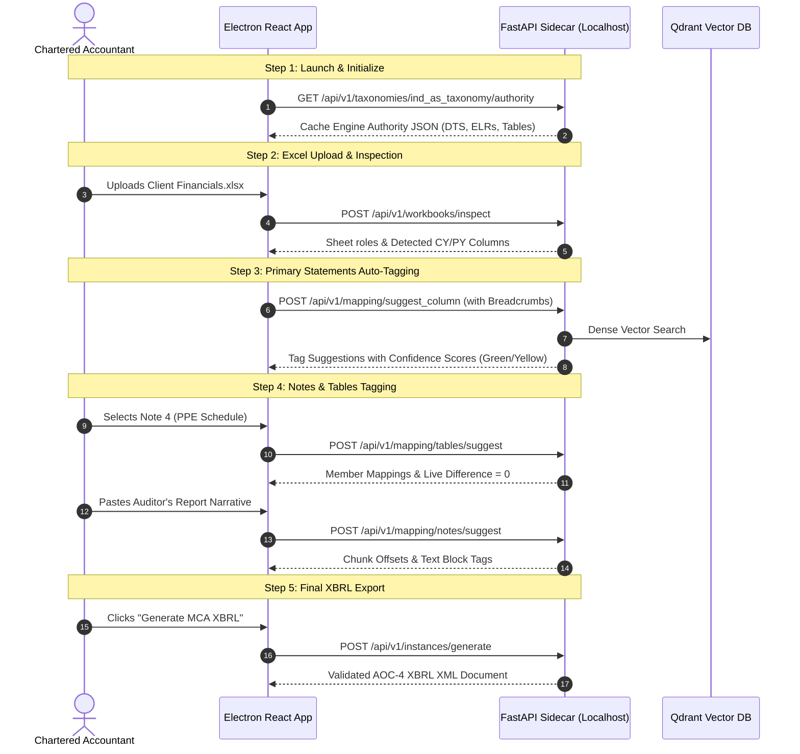

# XBRL Autopilot · FastAPI Sidecar Complete Architecture & Route Workflow

> **Scope**: This document defines the **FastAPI Sidecar** backend architecture, internal mechanics, and every single HTTP endpoint. It explains how each service is constructed internally (Hybrid Retrieval, BM25 + Qdrant, FlashRank Reranker, Python-Calamine, LangGraph RAG, XML Serialization) with complete realistic request and response payloads, and how the Frontend (Electron/React Desktop App) consumes them.

---

## 1. Architectural Big Picture: Frontend vs. FastAPI Sidecar

The XBRL Autopilot architecture follows a **Hybrid Separation of Concerns**:

```
┌────────────────────────────────────────────────────────────────────────┐
│               ELECTRON DESKTOP APP (Frontend: React 19 + TypeScript)    │
│                                                                        │
│  • Startup Cache: Pulls Taxonomy Engine Authority JSON once on startup │
│  • Fast UI Navigation: Renders 5,647 concepts & 66 ELRs at 60 FPS      │
│  • In-Memory Live Validation: Instant calculation & rollup checks       │
│  • Absolute Client Confidentiality: Financial numbers stay 100% local  │
└──────────────────────────────────┬─────────────────────────────────────┘
                                   │ HTTP (127.0.0.1:<port>)
                                   │ Authorization: Bearer <per-launch-token>
                                   ▼
┌────────────────────────────────────────────────────────────────────────┐
│                     FASTAPI SIDECAR (Backend: Python)                  │
│                                                                        │
│  [Stateless Compute Engine: Heavy AI/ML, Vectors, Rerankers & Parsers] │
│  ├─ 1. Taxonomy & Knowledge Authority Provider (Engine Authority)      │
│  ├─ 2. Workbook Inspection & Reading (Rust-based Calamine engine)      │
│  ├─ 3. Column-Based Auto-Tagging (BM25 + Qdrant Dense + FlashRank)     │
│  ├─ 4. Notes Chunking & Matching ([E] Text Block AI Classifier)        │
│  ├─ 5. Table Schedule Mapping ([T] Dimensional Member Matcher)         │
│  ├─ 6. AI Copilot Chatbot (LangGraph + RAG over MCA Statutory Rules)   │
│  └─ 7. Deterministic Instance XML Generator (MCA AOC-4 XBRL Output)    │
└────────────────────────────────────────────────────────────────────────┘
```

### Why not do everything in the Frontend?
1. **Machine Learning & Neural Rerankers**: The hybrid search pipeline uses Sentence-Transformers (`all-mpnet-base-v2`, 768-dim embeddings) and FlashRank cross-encoder (`ms-marco-TinyBERT-L-2-v2`). These require Python ML runtimes and cannot run inside Node.js or a browser renderer without huge binary bloat and memory thrashing.
2. **High-Performance Excel Parsing**: The Rust-backed `python-calamine` parser extracts multi-sheet Excel files (including legacy `.xls` BIFF binary formats) in milliseconds without loading heavy GUI dependencies.
3. **Statutory Knowledge Graph**: The MCA rules, definitions, calculation weights, and vector databases reside in the backend sidecar.

### Why not do everything in FastAPI (Server-Side UI)?
1. **Sub-millisecond UI Responsiveness**: If every click on a Balance Sheet tree node or every cell edit made a REST request to FastAPI, the CA would experience UI stutter. The Frontend pulls the compiled taxonomy authority JSON once and runs tree expansion and live arithmetic difference counters locally in 0ms.

---

## 2. Global Standards & Envelope Conventions

Every response from FastAPI adheres to the standard XAP envelope format:

```json
{
  "data": { ... },
  "message": "Human-readable status description",
  "success": true,
  "errors": null
}
```

In case of error (`success: false`):
```json
{
  "data": null,
  "message": "Entity not found or validation failed",
  "success": false,
  "errors": ["Specific field error or rule violation"]
}
```

---

## 3. Detailed Route Specifications

---

### GROUP A: System & Taxonomy Authority Endpoints

#### 1. `GET /health`
* **Purpose**: Health check and capability negotiation called by Electron on app launch. Electron waits for this endpoint to return `status: "ok"` before rendering the main dashboard.
* **Internal Mechanics**: Checks active vector collections in Qdrant, verifies loaded taxonomies, and detects Groq LLM API key status.
* **Frontend Context**: Electron polls this during initial startup splash screen ("Starting XBRL Sidecar...").
* **Request**: None (`GET /health`)
* **Response**:
  ```json
  {
    "status": "ok",
    "version": "0.1.0",
    "taxonomies": ["ci_taxonomy", "ind_as_taxonomy", "cost_taxonomy"],
    "collections": ["ci_taxonomy", "cost_taxonomy", "ind_as_taxonomy", "xbrl_agent"],
    "ai": {
      "enabled": true,
      "model": "llama-3.3-70b-versatile"
    }
  }
  ```

---

#### 2. `GET /api/v1/taxonomies`
* **Purpose**: Lists all officially supported MCA taxonomies.
* **Internal Mechanics**: Reads supported taxonomies metadata registry.
* **Frontend Context**: Displayed in the "New Filing Wizard" dropdown where the CA selects whether they are filing under **Ind AS 2017**, **C&I 2016**, or **Costing**.
* **Request**: None (`GET /api/v1/taxonomies`)
* **Response**:
  ```json
  {
    "data": {
      "taxonomies": [
        {
          "id": "ind_as_taxonomy",
          "name": "Indian Accounting Standards (Ind AS)",
          "version": "2017-03-31",
          "available": true
        },
        {
          "id": "ci_taxonomy",
          "name": "Companies and Industry (C&I)",
          "version": "2016-03-31",
          "available": true
        },
        {
          "id": "cost_taxonomy",
          "name": "Costing (CRA-4)",
          "version": "2019-03-31",
          "available": true
        }
      ]
    },
    "message": "List of available Taxonomies done",
    "success": true,
    "errors": null
  }
  ```

---

#### 3. `GET /api/v1/taxonomies/{id}/authority`
* **Purpose**: Serves the complete compiled Engine Authority JSON (~5-10 MB) as raw bytes.
* **Internal Mechanics**: Reads `knowledge_base/<id>_engine_authority.json`. Contains DTS entry points, namespaces, dimensional hypercube models, type facets, and calculation linkbases. Served without runtime JSON re-serialization for lightning speed.
* **Frontend Context**: Electron fetches this once per project session and stores it in memory. This enables the Desktop App to render trees, show/hide members, and validate rollups offline without network lag.
* **Request**: `GET /api/v1/taxonomies/ind_as_taxonomy/authority`
* **Response**:
  ```json
  {
    "data": {
      "meta": {
        "taxonomy": "ind_as",
        "taxonomyHash": "8f39a1c4e7b2d56a",
        "entryPoint": "in-ci-ent-2017-03-31.xsd",
        "schemaRef": "https://www.mca.gov.in/V3XBRL/2017/07/16/Taxonomy/Ind/in-ci-ent-2017-03-31.xsd",
        "cinScheme": "http://www.mca.gov.in/CIN"
      },
      "namespaces": {
        "in-ca": "http://www.mca.gov.in/XBRL/2017/03/31/in-ca",
        "ind-as": "http://www.mca.gov.in/XBRL/2017/03/31/ind-as",
        "xbrli": "http://www.xbrl.org/2003/instance"
      },
      "concepts": { ... },
      "tables": { ... },
      "elrs": [ ... ]
    },
    "message": "Engine authority",
    "success": true,
    "errors": null
  }
  ```

---

#### 4. `GET /api/v1/taxonomies/{id}/engine-rules`
* **Purpose**: Serves the precompiled Executable MCA Business Rules AST bundle.
* **Internal Mechanics**: Built from the official MCA Business Rules Excel sheet. Contains Abstract Syntax Trees (`when: { op: "==", fact: TagA, const: true }, type: "mandatory", concept: TagB`). Tied to the authority via `meta.taxonomyHash`.
* **Frontend Context**: Loaded into `@xap/engine` in Electron. Every time the CA types or changes a cell, these AST rules evaluate in memory to immediately flag problems (e.g., if Paid-up capital > 0 but Share Capital note is empty).
* **Request**: `GET /api/v1/taxonomies/ind_as_taxonomy/engine-rules`
* **Response**:
  ```json
  {
    "data": {
      "meta": {
        "taxonomy": "ind_as_taxonomy",
        "taxonomyHash": "8f39a1c4e7b2d56a",
        "totalRules": 1351,
        "executableCount": 1273
      },
      "rules": [
        {
          "id": "SR-L1001-1",
          "elr": "110000",
          "severity": "ERROR",
          "expression": {
            "if": { ">": ["in-ca:PaidUpCapital", 0] },
            "then": { "mandatory": ["in-ca:DisclosureOfShareCapitalNote"] }
          },
          "message": "Disclosure of Share Capital Note is mandatory when paid-up capital is positive."
        }
      ]
    },
    "message": "Executable business rules",
    "success": true,
    "errors": null
  }
  ```

---

#### 5. `GET /api/v1/taxonomies/{id}/elrs`
* **Purpose**: Returns the list of all Extended Link Roles (statements, schedules, disclosures) with their code, title, and group.
* **Internal Mechanics**: Extracts presentation roles, sorts by statement code (e.g., `110000` = Balance sheet, `210000` = P&L, `400600` = PPE Schedule), and categorizes into `Balance Sheet`, `Profit & Loss`, `Cash Flow`, `Corporate Info`, and `Notes`.
* **Frontend Context**: Populates the left navigation sidebar ("Statements & Disclosures"). Clicking any ELR opens its tagging sheet.
* **Request**: `GET /api/v1/taxonomies/ind_as_taxonomy/elrs`
* **Response**:
  ```json
  {
    "data": [
      {
        "code": "110000",
        "title": "Balance sheet",
        "group": "Balance Sheet",
        "uri": "http://www.mca.gov.in/role/ind-as/BalanceSheet"
      },
      {
        "code": "210000",
        "title": "Statement of profit and loss",
        "group": "Profit & Loss",
        "uri": "http://www.mca.gov.in/role/ind-as/ProfitAndLoss"
      },
      {
        "code": "400600",
        "title": "Property, plant and equipment",
        "group": "Notes",
        "uri": "http://www.mca.gov.in/role/ind-as/PropertyPlantAndEquipment"
      }
    ],
    "message": "60 ELRs in taxonomy 'ind_as_taxonomy'",
    "success": true,
    "errors": null
  }
  ```

---

#### 6. `GET /api/v1/taxonomies/{id}/elrs/{key}/tree`
* **Purpose**: Retrieves the hierarchical presentation tree for a specific statement or note.
* **Internal Mechanics**: Traverses `presentationArc` relationships starting from root abstract elements, ordering siblings by `arc.order`, and attaching concept metadata (periodType, balance, dataType, indicator flags like `[T]` for Table or `[E]` for Explanatory Text Block).
* **Frontend Context**: Renders the XBRL Statement Tree View where line items are presented in formal MCA hierarchy with indents.
* **Request**: `GET /api/v1/taxonomies/ind_as_taxonomy/elrs/110000/tree`
* **Response**:
  ```json
  {
    "data": {
      "elrCode": "110000",
      "root": [
        {
          "qname": "ind-as:BalanceSheetAbstract",
          "label": "Balance sheet [Abstract]",
          "isAbstract": true,
          "children": [
            {
              "qname": "ind-as:AssetsAbstract",
              "label": "Assets [Abstract]",
              "isAbstract": true,
              "children": [
                {
                  "qname": "ind-as:PropertyPlantAndEquipment",
                  "label": "Property, plant and equipment at end of period",
                  "isAbstract": false,
                  "periodType": "instant",
                  "balance": "debit",
                  "dataType": "monetaryItemType",
                  "indicator": "T",
                  "hasTable": true,
                  "children": []
                }
              ]
            }
          ]
        }
      ]
    },
    "message": "Presentation tree of '110000'",
    "success": true,
    "errors": null
  }
  ```

---

### GROUP B: Workbook Reading & Schema Detection Endpoints

#### 7. `POST /api/v1/workbooks/inspect`
* **Purpose**: Inspects an uploaded client Excel workbook (`.xlsx`, `.xlsm`, or binary `.xls`), classifies the accounting role of each sheet (Balance Sheet, P&L, Notes, or Ignored), and detects key columns (Particulars label column, Note reference column, Current Year amount column, Previous Year amount column).
* **Internal Mechanics**:
  - Uses `python-calamine` to extract sheet headers without Excel dependencies.
  - Scores sheet names against accounting heuristics (`bs`, `balance sheet`, `p&l`, `notes`, `tb`).
  - Scans rows 0-10 for date headers (`31-03-2026`, `2025-26`, `FY 25`) to identify CY vs. PY columns.
* **Frontend Context**: Powering the **Workbook Schema & Column Mapper Wizard**. When the CA drops an Excel file, this endpoint previews the detected sheets and preselects column assignments before mapping starts.
* **Request**:
  ```json
  {
    "fileName": "Dixon_Financials_FY26.xlsx",
    "contentBase64": "UEsDBBQAAAAIA..."
  }
  ```
* **Response**:
  ```json
  {
    "data": {
      "filename": "Dixon_Financials_FY26.xlsx",
      "sheets": [
        {
          "name": "BS_Standalone",
          "rowCount": 65,
          "colCount": 6,
          "sampleRows": [
            ["Particulars", "Note No.", "Figures as at 31-03-2026", "Figures as at 31-03-2025"],
            ["Equity Share Capital", "3", "41783000", "41783000"]
          ],
          "suggestedRole": "balance_sheet",
          "detectedColumns": {
            "labelCol": "A",
            "noteCol": "B",
            "cyCol": "C",
            "pyCol": "D"
          }
        },
        {
          "name": "PL_Statement",
          "rowCount": 45,
          "colCount": 5,
          "suggestedRole": "profit_and_loss",
          "detectedColumns": {
            "labelCol": "A",
            "noteCol": "B",
            "cyCol": "C",
            "pyCol": "D"
          }
        },
        {
          "name": "TrialBalance_Raw",
          "rowCount": 500,
          "colCount": 12,
          "suggestedRole": "ignored",
          "detectedColumns": {}
        }
      ]
    },
    "message": "Workbook schema inspected",
    "success": true,
    "errors": null
  }
  ```

---

#### 8. `POST /api/v1/workbooks/read`
* **Purpose**: Converts binary Excel files into a normalized JSON grid structure (`WorkbookModel`) that can be rendered directly into the Univer spreadsheet component.
* **Internal Mechanics**: Parses cell values, merged regions, formula values, and numeric rounding via Rust Calamine engine.
* **Frontend Context**: Called when the user views the interactive spreadsheet editor in the left pane of the application.
* **Request**:
  ```json
  {
    "fileName": "Financials.xls",
    "contentBase64": "0M8R4KGxGuE..."
  }
  ```
* **Response**:
  ```json
  {
    "data": {
      "fileName": "Financials.xls",
      "sheets": [
        {
          "name": "BS",
          "rowCount": 65,
          "colCount": 6,
          "cells": {
            "A1": { "v": "EQUITY AND LIABILITIES", "t": "s" },
            "C1": { "v": 41783000, "t": "n" }
          },
          "merges": ["A1:B1"]
        }
      ]
    },
    "message": "Workbook read",
    "success": true,
    "errors": null
  }
  ```

---

### GROUP C: Intelligent AI Auto-Tagging Endpoints

#### 9. `POST /api/v1/mapping/suggest_column`
* **Purpose**: Auto-tags a batch of financial statement line items from client Excel sheets with 98%+ accuracy. Resolves hierarchical ambiguity using **Breadcrumb Context Enrichment**.
* **Internal Mechanics**:
  1. Combines `breadcrumb_path` + row `label` (e.g. `"Equity & Liabilities > Shareholders Funds > Share Capital"`).
  2. Runs **Ensemble Hybrid Retrieval**:
     - Dense vector embedding (`sentence-transformers/all-mpnet-base-v2`, 768-dim) against Qdrant Cloud.
     - BM25 keyword matching across taxonomy concept labels.
  3. Evaluates with **FlashRank Cross-Encoder** neural reranker (`ms-marco-TinyBERT-L-2-v2`).
  4. Returns the top best match with confidence score and alternative candidates.
* **Frontend Context**: Triggered when the CA clicks "Auto Tag Sheet" in the Balance Sheet or P&L tab. Tagged items turn green (confident) or yellow (review needed).
* **Request**:
  ```json
  {
    "taxonomy": "ind_as_taxonomy",
    "sheetRole": "balance_sheet",
    "items": [
      {
        "row": 9,
        "label": "Share Capital",
        "noteRef": "3",
        "breadcrumb_path": ["Equity & Liabilities", "Shareholders' Funds"]
      },
      {
        "row": 15,
        "label": "Trade Receivables",
        "noteRef": "7",
        "breadcrumb_path": ["Financial Assets", "Current Assets"]
      }
    ],
    "context": {
      "levelOfRounding": "Actual",
      "cyPeriod": "2026-03-31",
      "pyPeriod": "2025-03-31"
    }
  }
  ```
* **Response**:
  ```json
  {
    "data": {
      "suggestions": [
        {
          "row": 9,
          "label": "Share Capital",
          "bestMatch": {
            "concept": "ind-as:EquityShareCapital",
            "label": "Equity share capital at end of period",
            "score": 0.985,
            "origin": "exact_semantic"
          },
          "alternatives": [
            {
              "concept": "ind-as:OtherEquity",
              "label": "Other equity at end of period",
              "score": 0.612
            }
          ]
        },
        {
          "row": 15,
          "label": "Trade Receivables",
          "bestMatch": {
            "concept": "ind-as:TradeReceivablesCurrent",
            "label": "Trade receivables, current",
            "score": 0.974,
            "origin": "exact_semantic"
          },
          "alternatives": []
        }
      ]
    },
    "message": "Suggested mappings for 2 items",
    "success": true,
    "errors": null
  }
  ```

---

#### 10. `POST /api/v1/mapping/notes/suggest`
* **Purpose**: Auto-tags narrative text documents (Director's Report, Auditor's Report, Accounting Policies). Chunks raw text by section headings and matches paragraphs to Ind AS `[Text Block]` elements.
* **Internal Mechanics**:
  1. `notes_chunker.py` parses text using regex heading detection (`1.1`, All-Caps headings, markdown hashes) and records exact character offsets `[startOffset, endOffset]`.
  2. `notes_suggest.py` filters candidates strictly to `type="textBlockItemType"` or `type="nonnum:textBlockItemType"`.
  3. Matches the combined heading and body against the vector database and reranks candidates.
* **Frontend Context**: Used in the **Notes & Disclosures Tagging View** (Section `[E]`). Chunks are highlighted in blue in the document viewer, and clicking a chunk opens the suggested tag card with 1-click approval.
* **Request**:
  ```json
  {
    "taxonomy": "ind_as_taxonomy",
    "documentType": "directors_report",
    "text": "DIRECTORS' REPORT\n\n1. FINANCIAL SUMMARY\nThe company achieved revenue of Rs 1,200 Crores during FY 2025-26.\n\n2. DIVIDEND\nThe Board of Directors recommended a final dividend of Rs 2.50 per share.\n\n3. SIGNIFICANT ACCOUNTING POLICIES\nProperty, plant and equipment are stated at cost less accumulated depreciation.",
    "format": "text"
  }
  ```
* **Response**:
  ```json
  {
    "data": {
      "chunks": [
        {
          "chunkId": "chunk_01",
          "heading": "DIRECTORS' REPORT > 1. FINANCIAL SUMMARY",
          "startOffset": 19,
          "endOffset": 104,
          "text": "The company achieved revenue of Rs 1,200 Crores during FY 2025-26.",
          "bestMatch": {
            "concept": "in-ca:FinancialSummaryOrHighlightsExplanatory",
            "label": "Financial summary or highlights [Text Block]",
            "score": 0.965
          },
          "alternatives": []
        },
        {
          "chunkId": "chunk_02",
          "heading": "DIRECTORS' REPORT > 2. DIVIDEND",
          "startOffset": 106,
          "endOffset": 204,
          "text": "The Board of Directors recommended a final dividend of Rs 2.50 per share.",
          "bestMatch": {
            "concept": "in-ca:DividendExplanatory",
            "label": "Dividend [Text Block]",
            "score": 0.982
          },
          "alternatives": []
        },
        {
          "chunkId": "chunk_03",
          "heading": "DIRECTORS' REPORT > 3. SIGNIFICANT ACCOUNTING POLICIES",
          "startOffset": 206,
          "endOffset": 332,
          "text": "Property, plant and equipment are stated at cost less accumulated depreciation.",
          "bestMatch": {
            "concept": "ind-as:DescriptionOfAccountingPolicyForPropertyPlantAndEquipmentExplanatory",
            "label": "Description of accounting policy for property, plant and equipment [Text Block]",
            "score": 0.991
          },
          "alternatives": []
        }
      ]
    },
    "message": "Suggested mappings for 3 text blocks",
    "success": true,
    "errors": null
  }
  ```

---

#### 11. `POST /api/v1/mapping/tables/suggest`
* **Purpose**: Auto-tags dimensional schedules (e.g. Property, Plant & Equipment schedule, Borrowings schedule). Maps client schedule rows to standard taxonomy members (`*Member`), handles total rows, creates custom member placeholders, and provides live Balance Sheet difference reconciliation.
* **Internal Mechanics**:
  1. Inspects `ind_as_engine_authority.json` to find the exact Hypercube Table (`*Table`) and Dimension Axis (`*Axis`).
  2. Compares row labels against standard members under `dimension-domain` and `domain-member` relationships.
  3. Detects total rows (`"Total Property, Plant and Equipment"`) and marks them with `isTotalRow: true`.
  4. Calculates live reconciliation between Schedule Total and Balance Sheet parent line item (`scheduleTotal - balanceSheetAmount = diff`).
* **Frontend Context**: Powering the **Dedicated Table Modal (`[T]`)**. Displays row mappings, member pickers, and the real-time bottom reconciliation bar (`BS Diff = 0`).
* **Request**:
  ```json
  {
    "taxonomy": "ind_as_taxonomy",
    "tableQname": "ind-as:PropertyPlantAndEquipmentTable",
    "scheduleName": "Note 4: Property, Plant and Equipment",
    "rows": [
      { "rowIdx": 5, "label": "Freehold Land", "amount": 12000000 },
      { "rowIdx": 6, "label": "Factory Buildings", "amount": 45000000 },
      { "rowIdx": 7, "label": "Plant and Machinery", "amount": 83000000 },
      { "rowIdx": 8, "label": "Total PPE", "amount": 140000000 }
    ],
    "balanceSheetAmount": 140000000
  }
  ```
* **Response**:
  ```json
  {
    "data": {
      "table": "ind-as:PropertyPlantAndEquipmentTable",
      "axis": "ind-as:ClassesOfPropertyPlantAndEquipmentAxis",
      "domain": "ind-as:PropertyPlantAndEquipmentMember",
      "rowMappings": [
        {
          "rowIdx": 5,
          "rowText": "Freehold Land",
          "member": "ind-as:LandMember",
          "memberLabel": "Land [Member]",
          "isStandard": true,
          "isTotalRow": false
        },
        {
          "rowIdx": 6,
          "rowText": "Factory Buildings",
          "member": "ind-as:BuildingsMember",
          "memberLabel": "Buildings [Member]",
          "isStandard": true,
          "isTotalRow": false
        },
        {
          "rowIdx": 7,
          "rowText": "Plant and Machinery",
          "member": "ind-as:PlantAndEquipmentMember",
          "memberLabel": "Plant and equipment [Member]",
          "isStandard": true,
          "isTotalRow": false
        },
        {
          "rowIdx": 8,
          "rowText": "Total PPE",
          "member": "ind-as:PropertyPlantAndEquipmentMember",
          "memberLabel": "Property, plant and equipment [Member]",
          "isStandard": true,
          "isTotalRow": true
        }
      ],
      "reconciliation": {
        "scheduleTotal": 140000000,
        "balanceSheetAmount": 140000000,
        "difference": 0,
        "isBalanced": true
      }
    },
    "message": "Suggested dimensional mappings for table",
    "success": true,
    "errors": null
  }
  ```

---

### GROUP D: Instance Generation Endpoint

#### 12. `POST /api/v1/instances/generate`
* **Purpose**: Generates the final, production-grade MCA AOC-4 XBRL XML instance document.
* **Internal Mechanics**:
  1. Serializes root element `<xbrli:xbrl>` with prescribed schemaRef and namespaces.
  2. Constructs sorted, deterministic contexts (`CY`, `PY`, `PYO`) with entity CIN scheme.
  3. Injects dimensional `<xbrli:scenario>` blocks with `<xbrldi:explicitMember>` elements for schedules.
  4. Formats monetary units (`iso4217:INR`), pure shares (`xbrli:shares`), and decimal rounding.
  5. Deterministically emits facts ordered by primary presentation ELR position.
* **Frontend Context**: Triggered on the **"Export & Generate XBRL"** button or Monaco XML editor tab.
* **Request**:
  ```json
  {
    "taxonomy": "ind_as_2017",
    "cin": "U72200KA2010PLC123456",
    "companyName": "Dixon Technologies Private Limited",
    "fyStart": "2025-04-01",
    "fyEnd": "2026-03-31",
    "natureOfReport": "Standalone",
    "levelOfRounding": "Actual",
    "facts": [
      {
        "concept": "in-ca:CorporateIdentityNumber",
        "value": "U72200KA2010PLC123456",
        "periodType": "duration",
        "startDate": "2025-04-01",
        "endDate": "2026-03-31"
      },
      {
        "concept": "ind-as:EquityShareCapital",
        "value": "41783000",
        "periodType": "instant",
        "instantDate": "2026-03-31",
        "unit": "INR",
        "decimals": "0"
      },
      {
        "concept": "ind-as:GrossCarryingAmount",
        "value": "12000000",
        "periodType": "instant",
        "instantDate": "2026-03-31",
        "unit": "INR",
        "decimals": "0",
        "dimensions": [
          {
            "axis": "ind-as:ClassesOfPropertyPlantAndEquipmentAxis",
            "member": "ind-as:LandMember"
          }
        ]
      }
    ]
  }
  ```
* **Response**:
  ```json
  {
    "data": {
      "filename": "AOC4_XBRL_U72200KA2010PLC123456_2025-26.xml",
      "factCount": 3,
      "contextCount": 2,
      "xml": "<?xml version=\"1.0\" encoding=\"UTF-8\"?>\n<!-- Generated by XBRL Autopilot build 2026.11 -->\n<xbrli:xbrl xmlns:xbrli=\"http://www.xbrl.org/2003/instance\" xmlns:link=\"http://www.xbrl.org/2003/linkbase\" xmlns:xlink=\"http://www.w3.org/1999/xlink\" xmlns:in-ca=\"http://www.mca.gov.in/XBRL/2017/03/31/in-ca\" xmlns:ind-as=\"http://www.mca.gov.in/XBRL/2017/03/31/ind-as\" xmlns:iso4217=\"http://www.xbrl.org/2003/iso4217\" xmlns:xbrldi=\"http://xbrl.org/2006/xbrldi\">\n  <link:schemaRef xlink:type=\"simple\" xlink:href=\"https://www.mca.gov.in/V3XBRL/2017/07/16/Taxonomy/Ind/in-ci-ent-2017-03-31.xsd\"/>\n  <xbrli:context id=\"D2026\">\n    <xbrli:entity><xbrli:identifier scheme=\"http://www.mca.gov.in/CIN\">U72200KA2010PLC123456</xbrli:identifier></xbrli:entity>\n    <xbrli:period><xbrli:startDate>2025-04-01</xbrli:startDate><xbrli:endDate>2026-03-31</xbrli:endDate></xbrli:period>\n  </xbrli:context>\n  <xbrli:context id=\"I2026\">\n    <xbrli:entity><xbrli:identifier scheme=\"http://www.mca.gov.in/CIN\">U72200KA2010PLC123456</xbrli:identifier></xbrli:entity>\n    <xbrli:period><xbrli:instant>2026-03-31</xbrli:instant></xbrli:period>\n  </xbrli:context>\n  <xbrli:context id=\"I2026_d7a8b9\">\n    <xbrli:entity><xbrli:identifier scheme=\"http://www.mca.gov.in/CIN\">U72200KA2010PLC123456</xbrli:identifier></xbrli:entity>\n    <xbrli:period><xbrli:instant>2026-03-31</xbrli:instant></xbrli:period>\n    <xbrli:scenario>\n      <xbrldi:explicitMember dimension=\"ind-as:ClassesOfPropertyPlantAndEquipmentAxis\">ind-as:LandMember</xbrldi:explicitMember>\n    </xbrli:scenario>\n  </xbrli:context>\n  <xbrli:unit id=\"INR\"><xbrli:measure>iso4217:INR</xbrli:measure></xbrli:unit>\n  <in-ca:CorporateIdentityNumber contextRef=\"D2026\">U72200KA2010PLC123456</in-ca:CorporateIdentityNumber>\n  <ind-as:EquityShareCapital contextRef=\"I2026\" unitRef=\"INR\" decimals=\"0\">41783000</ind-as:EquityShareCapital>\n  <ind-as:GrossCarryingAmount contextRef=\"I2026_d7a8b9\" unitRef=\"INR\" decimals=\"0\">12000000</ind-as:GrossCarryingAmount>\n</xbrli:xbrl>"
    },
    "message": "XBRL instance XML generated successfully",
    "success": true,
    "errors": null
  }
  ```

---

### GROUP E: In-Memory AI Copilot Chatbot Endpoints

#### 13. `POST /api/v1/conversations`
* **Purpose**: Initializes a new isolated in-memory conversational thread.
* **Internal Mechanics**: Creates a LangGraph thread checkpoint in `InMemorySaver`. Zero database footprint.
* **Frontend Context**: Called when the CA clicks "+ New Chat" in the left `AI ASSISTANT` panel.
* **Request**:
  ```json
  {
    "title": "Ind AS 115 Revenue Query"
  }
  ```
* **Response**:
  ```json
  {
    "data": {
      "conversation_id": "conv_a8b9c1d2e3f4",
      "title": "Ind AS 115 Revenue Query",
      "created_at": "2026-11-17T22:10:00Z"
    },
    "message": "Conversation created",
    "success": true,
    "errors": null
  }
  ```

---

#### 14. `POST /api/v1/conversations/{id}/messages` (or `POST /api/v1/chat`)
* **Purpose**: Sends a question to the in-memory XBRL Copilot. Supports direct JSON response and Server-Sent Events (SSE) streaming.
* **Internal Mechanics**:
  - LangGraph StateGraph executes: Guardrail $\rightarrow$ Planner $\rightarrow$ Retriever (Qdrant `xbrl_agent` + TinyBERT reranker) $\rightarrow$ Responder (Groq Llama 3.3).
  - Streams tokens with RAG citations pointing to MCA Statutory Manuals and Taxonomy rules.
* **Frontend Context**: Chat input box in the `AI ASSISTANT` panel.
* **Request**:
  ```json
  {
    "message": "Is Share Capital note mandatory if Paid-up capital is positive?",
    "stream": false
  }
  ```
* **Response**:
  ```json
  {
    "data": {
      "reply": "Yes. According to MCA Ind AS Business Rule SR-L1001-1, whenever `in-ca:PaidUpCapital` is greater than zero, the detailed disclosure note `in-ca:DisclosureOfShareCapitalNote` is strictly mandatory. Leaving this blank will trigger an MCA validation error.",
      "citations": [
        {
          "title": "MCA Ind AS Business Rules 2017",
          "ruleId": "SR-L1001-1",
          "relevance": 0.98
        }
      ]
    },
    "message": "Message sent",
    "success": true,
    "errors": null
  }
  ```

---

## 4. End-to-End Filing Execution Flow



This document establishes the single source of truth for the FastAPI sidecar API contract.
