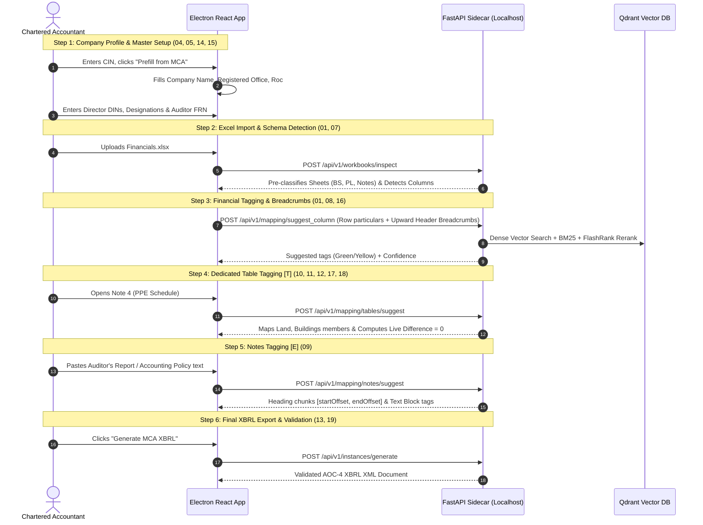

# XBRL Autopilot · Master Workflow, UI Blueprints & FastAPI Specs

> **Scope**: This is the single authoritative specification document for XBRL Autopilot. It bridges the real-world Chartered Accountant workflows (observed from Webtel webXBRL video analysis) with the **FastAPI Sidecar** backend architecture, internal mechanics, and API endpoints.

---

## 1. Real-World Analysis: Webtel WebXBRL Top Navigation & Screens

From deep frame-by-frame extraction of the official 1080p Webtel webXBRL video (`https://youtu.be/2MmlPon1NhY`), the system is structured into **7 top-level tabs**:

```
┌──────────────────────────────────────────────────────────────────────────────────────────────────────────────────┐
│ Master  │  Financial Tagging  │  Notes Tagging  │  Fixed Assets  │  Generate Tuples  │  Validation Tool  │ Utilities│
└──────────────────────────────────────────────────────────────────────────────────────────────────────────────────┘
```

### Complete Video Screenshot Reference Directory (`docs/ui/`)

| Screenshot Name                                                 | Video Timestamp | Screen Function & What It Proves                                                                                                             |
| :-------------------------------------------------------------- | :-------------: | :------------------------------------------------------------------------------------------------------------------------------------------- |
| **`01-financial-tagging-balance-sheet.png`**            |      05:00      | Financial Tagging: Balance sheet imported Excel sheet and cell grid                                                                          |
| **`02-both-statements-and-notes-tree.png`**             |      06:20      | Combined Statement and Notes presentation linkbase tree                                                                                      |
| **`03-process-flow-dashboard.png`**                     |      00:40      | Overall process flow: Master Setup $\rightarrow$ Financial Tagging $\rightarrow$ Notes $\rightarrow$ Tables $\rightarrow$ Validation |
| **`04-company-master-cin-prefill.png`**                 |      01:20      | **Master Tab**: Company Master setup with CIN, Name, Roc, and "Prefill from MCA" button                                                |
| **`05-director-master-setup.png`**                      |      02:20      | **Master Tab**: Director Master list — DIN, Name, Designation, Date of Appointment                                                    |
| **`06-document-master-upload.png`**                     |      04:20      | **Master Tab**: Document Master for uploading Financial Statements & Board Report attachments                                          |
| **`07-f9-column-gap-setting.png`**                      |      05:40      | Financial Tagging: F9 column mapping dialog (`Particulars`, `CY`, `PY`)                                                                |
| **`08-cell-options-context-menu.png`**                  |      07:40      | Right-click context menu on cell: Link `[L]`, Pick number from string, Tag Member                                                          |
| **`09-notes-tagging-text-blocks.png`**                  |      09:20      | Notes Tagging: Narrative text blocks (`[E]`) and note disclosures                                                                          |
| **`10-table-tagging-dedicated-window.png`**             |      11:20      | Dedicated Table Modal (`[T]`) for multi-dimensional schedule tagging                                                                       |
| **`11-table-show-hide-members-modal.png`**              |      12:00      | Show/Hide Members dialog to filter out unused taxonomy members                                                                               |
| **`12-table-difference-reconciliation.png`**            |      14:00      | Live bottom reconciliation bar showing Balance Sheet Target vs Schedule Total                                                                |
| **`13-mca-validation-colored-errors.png`**              |      17:00      | Final Validation Report: Red = Mandatory/Schema Error, Blue/Green = Accepted                                                                 |
| **`14-auditor-master-setup.png`**                       |      03:50      | **Master Tab**: Auditor Master setup — Firm Registration No (FRN), Auditor Name, PAN, Membership No                                   |
| **`15-directors-master-detail.png`**                    |      03:00      | **Master Tab**: Detailed Director Master form — DIN, Category (Executive/Independent), Designation                                    |
| **`16-taxonomy-presentation-and-calculation-tree.png`** |      06:20      | Dual tabs: Presentation Tree vs Calculation Math equations                                                                                   |
| **`17-fixed-assets-schedule-grid.png`**                 |      11:20      | Fixed Assets schedule breakdown grid (Gross Block, Depr, Net Block)                                                                          |
| **`18-difference-reconciliation-red-error.png`**        |      15:20      | Red alert when Schedule Total $\neq$ Balance Sheet line item                                                                               |
| **`19-mca-validation-pass-screen.png`**                 |      17:30      | In-built validation clean pass before launching official MCA validator                                                                       |

---

## 2. Fundamental Workflow Clarifications (Addressing Real-World CAs)

### A. Master Setup Tab vs. Notes Tagging (Why They Are Completely Separate)

> [!IMPORTANT]
> **Director details, Company profile, and Auditors are NOT tagged from Excel notes!**
> In real-world filings, they are entered in the **Master Setup** tab:

1. **Company Master** (`04-company-master-cin-prefill.png`):
   - The CA enters the CIN (Corporate Identity Number) and clicks **"Prefill from MCA"**.
   - MCA web service fetches Company Name, Registered Office Address, Category, Sub-Category, and ROC Code.
2. **Director Master** (`05-director-master-setup.png`, `15-directors-master-detail.png`):
   - Table of all Directors: DIN, Full Name, Designation (Managing Director, Whole-time Director, Independent Director), Date of Appointment, Cessation Date, and Category.
   - Entered manually or prefilled once from MCA / last year's `.axbrl` project.
3. **Auditor Master** (`14-auditor-master-setup.png`):
   - Statutory Auditor Firm Name, Firm Registration Number (FRN), Individual Auditor Name, Membership Number, PAN, Address, and Auditor Type.
4. **Document Master** (`06-document-master-upload.png`):
   - Uploading required MCA attachments (Signed Balance Sheet, Director's Report, Auditor's Report, Notice of AGM).

**Where does Notes Tagging come in?**

* **Notes Tagging (`[E]`)** is reserved for **narrative disclosures** and financial notes:
  - Narrative **Board's Report / Director's Report Text** (`in-ca:BoardsReportExplanatory`).
  - Narrative **Auditor's Report Comments / Emphasis of Matter** (`in-ca:AuditorsReportExplanatory`).
  - **Accounting Policies** (`ind-as:DescriptionOfAccountingPolicy...Explanatory`).

---

### B. Balance Sheet Auto-Tagging & The Breadcrumb Trace Flow

#### The Upward Row Trace (How Parent Headings Are Detected)

When an accountant imports a Balance Sheet sheet into Univer, row particulars are organized hierarchically:

```
Row 1: EQUITY AND LIABILITIES            | CY: [EMPTY]    | PY: [EMPTY]   <-- Parent Level 1
Row 2:   Shareholders' funds             | CY: [EMPTY]    | PY: [EMPTY]   <-- Parent Level 2
Row 3:     Share Capital                 | CY: 4,17,83,000| PY: 4,17,83,000 <-- Value Row
Row 4:     Reserves and Surplus          | CY: 9,50,00,000| PY: 8,20,00,000 <-- Value Row
```

1. **Detection Heuristic**:
   - For any value row $N$ (where CY or PY contains an amount), the detector traces upwards ($N-1, N-2, \dots$):
   - If a row above has **EMPTY CY and EMPTY PY amounts** and non-empty text, it is classified as a **Section Heading**.
   - Tracing stops when the parent hierarchy boundary is reached.
2. **Breadcrumb Trail Created**:
   - For Row 3 ("Share Capital"), the breadcrumb is:
     `["EQUITY AND LIABILITIES", "Shareholders' funds"]`.
3. **Execution Sequence**:
   - CA opens the Balance Sheet sheet and clicks **"Auto Tag Sheet"**.
   - Frontend sends the rows + breadcrumbs to `POST /api/v1/mapping/suggest_column`.
   - FastAPI queries Qdrant with `"EQUITY AND LIABILITIES > Shareholders' funds > Share Capital"`.
   - Result: 98.5% match with `ind-as:EquityShareCapital`.
   - Frontend highlights the row green, fills cell coordinates, and lets the CA review.
   - CA clicks **"Next Sheet (P&L)"** and repeats the process.

---

### C. Notes Tagging (`[E]`): Text vs. Discrete Values & How LLM is Used

Notes Tagging contains **two distinct types of disclosures**:

```
                     ┌───────────────────────────────────┐
                     │          NOTES TAGGING            │
                     └─────────────────┬─────────────────┘
                                       │
                ┌──────────────────────┴──────────────────────┐
                ▼                                             ▼
     1. Text Blocks ([E])                         2. Discrete Note Values
  (Entire narrative paragraphs)                (Specific numbers inside note)
  • Significant Accounting Policies            • Statutory Audit Fee: ₹5,00,000
  • Contingent Liabilities note                • Tax Audit Fee: ₹1,00,000
  • CSR Policy & Activities                    • Number of Shares Issued: 41,78,300
```

#### How the LLM (Large Language Model) is Used in Notes Tagging:

1. **Semantic Text-to-Tag Classification**:
   - Client narrative text varies widely between companies.
   - LLM analyzes paragraph semantics and identifies which of the **405 Ind AS `[Text Block]` concepts** is the exact statutory match.
2. **MCA-Compliant XHTML Sanitization**:
   - The official MCA Validation Tool rejects invalid HTML, unclosed tags, JavaScript, and custom styling.
   - The LLM parses the copied text/Word document and formats it into clean, strict MCA-compatible XHTML (`<p>`, `<table>`, `<tr>`, `<td>`, `<b>`, `<ol>`).
3. **Mandatory Missing Disclosure Auditor**:
   - The LLM cross-examines tagged financial figures against statutory rules.
   - *Example*: If P&L shows `CorporateSocialResponsibilityExpense = ₹45,00,000`, the LLM alerts the CA:
     > *"You have reported CSR expenditure of ₹45 Lakhs, but `in-ca:CorporateSocialResponsibilityExplanatory` text block is missing. Tag this note to prevent MCA validation failure."*
     >

---

### D. Table Schedule Tagging (`[T]`): Concrete End-to-End Real Example

#### 1. Actual Client Excel Schedule (Note 4: Property, Plant & Equipment)

Suppose the client has the following schedule in their Excel workbook:

|     Row     | Line Item Particulars |  Gross Block Opening  | Additions During Year | Deductions |  Gross Block Closing  |   Acc. Depreciation   |  Net Carrying Amount  |
| :---------: | :-------------------- | :--------------------: | :-------------------: | :---------: | :--------------------: | :-------------------: | :--------------------: |
| **5** | Freehold Land         |      1,20,00,000      |           0           |      0      |      1,20,00,000      |           0           |      1,20,00,000      |
| **6** | Factory Buildings     |      4,00,00,000      |       50,00,000       |      0      |      4,50,00,000      |       45,00,000       |      4,05,00,000      |
| **7** | Plant & Machinery     |      7,50,00,000      |       80,00,000       |      0      |      8,30,00,000      |      1,20,00,000      |      7,10,00,000      |
| **8** | Office Equipment      |       50,00,000       |       10,00,000       |      0      |       60,00,000       |       15,00,000       |       45,00,000       |
| **9** | **Total PPE**   | **13,20,00,000** | **1,40,00,000** | **0** | **14,60,00,000** | **1,80,00,000** | **12,80,00,000** |

*Target on Balance Sheet*: Balance sheet Row 14 (`Property, Plant and Equipment at end of period`) = **₹12,80,00,000**.

#### 2. Request Sent from Frontend to FastAPI Sidecar

The CA clicks on the `[T]` indicator next to PPE on the Balance Sheet. Frontend sends:

```json
POST /api/v1/mapping/tables/suggest
Content-Type: application/json

{
  "taxonomy": "ind_as_taxonomy",
  "tableQname": "ind-as:PropertyPlantAndEquipmentTable",
  "scheduleName": "Note 4: Property, Plant and Equipment",
  "rows": [
    { "rowIdx": 5, "label": "Freehold Land", "amount": 12000000 },
    { "rowIdx": 6, "label": "Factory Buildings", "amount": 40500000 },
    { "rowIdx": 7, "label": "Plant & Machinery", "amount": 71000000 },
    { "rowIdx": 8, "label": "Office Equipment", "amount": 4500000 },
    { "rowIdx": 9, "label": "Total PPE", "amount": 128000000 }
  ],
  "balanceSheetAmount": 128000000
}
```

#### 3. Response Returned by FastAPI

```json
{
  "data": {
    "table": "ind-as:PropertyPlantAndEquipmentTable",
    "axis": "ind-as:ClassesOfPropertyPlantAndEquipmentAxis",
    "domain": "ind-as:PropertyPlantAndEquipmentMember",
    "rowMappings": [
      {
        "rowIdx": 5,
        "rowText": "Freehold Land",
        "member": "ind-as:LandMember",
        "memberLabel": "Land [Member]",
        "isStandard": true,
        "isTotalRow": false
      },
      {
        "rowIdx": 6,
        "rowText": "Factory Buildings",
        "member": "ind-as:BuildingsMember",
        "memberLabel": "Buildings [Member]",
        "isStandard": true,
        "isTotalRow": false
      },
      {
        "rowIdx": 7,
        "rowText": "Plant & Machinery",
        "member": "ind-as:PlantAndEquipmentMember",
        "memberLabel": "Plant and equipment [Member]",
        "isStandard": true,
        "isTotalRow": false
      },
      {
        "rowIdx": 8,
        "rowText": "Office Equipment",
        "member": "ind-as:FurnitureAndFixturesMember",
        "memberLabel": "Furniture and fixtures [Member]",
        "isStandard": true,
        "isTotalRow": false
      },
      {
        "rowIdx": 9,
        "rowText": "Total PPE",
        "member": "ind-as:PropertyPlantAndEquipmentMember",
        "memberLabel": "Property, plant and equipment [Member]",
        "isStandard": true,
        "isTotalRow": true
      }
    ],
    "reconciliation": {
      "scheduleTotal": 128000000,
      "balanceSheetAmount": 128000000,
      "difference": 0,
      "isBalanced": true
    }
  },
  "message": "Suggested dimensional mappings for table",
  "success": true,
  "errors": null
}
```

#### 4. How the Dedicated Table Modal (`10-table-tagging-dedicated-window.png`) Renders It:

1. Maps each row to its taxonomy member.
2. Total PPE (Row 9) is flagged `isTotalRow: true` (so it represents the parent domain rollup).
3. The bottom bar displays:
   `Schedule Total: ₹12,80,00,000 | BS Target: ₹12,80,00,000 | Difference: ₹0.00 (Balanced in Green)`
4. If a CA accidentally missed Office Equipment (₹45,00,000), the difference would show `-₹45,00,000 in Red` (`18-difference-reconciliation-red-error.png`), preventing erroneous MCA filing.

---

### E. Statutory & Historical Nomenclature: "Schedule" vs. "Note No." Column

Why do some financial statement spreadsheets (such as `17-fixed-assets-schedule-grid.png`) display the column heading as **"Schedule"** while others display **"Note No."**?

> [!NOTE]
> **"Schedule" and "Note No." are 100% functionally identical in Indian corporate accounting.**
> The variation is purely historical based on the governing Companies Act regime:

1. **Companies Act, 1956 (Old Schedule VI Regime)**:

   * Financial statements previously grouped itemized breakdowns under numbered **"Schedules"**:
     * Share Capital $\rightarrow$ **Schedule 1**
     * Reserves & Surplus $\rightarrow$ **Schedule 2**
     * Secured Loans $\rightarrow$ **Schedule 3**
     * Fixed Assets $\rightarrow$ **Schedule 5**
     * Investments $\rightarrow$ **Schedule 6**
   * Spreadsheets following this convention or software templates (such as the Webtel demo file from FY 2009-10) name the reference column **"Schedule"** or **"Sch No."**.
2. **Companies Act, 2013 & Ind AS (Schedule III Regime)**:

   * Modern MCA standards modernized the terminology from "Schedules" to **"Note No."** or **"Notes to Accounts"**:
     * Share Capital $\rightarrow$ **Note 3**
     * Property, Plant and Equipment (PPE) $\rightarrow$ **Note 4**
     * Borrowings $\rightarrow$ **Note 12**
3. **How XBRL Autopilot Handles Both Universally**:

   * Client Excel workbooks may use any of the following column headers:
     `Note No.`, `Note`, `Notes`, `Schedule`, `Sch No.`, `Sch`, or `Ref`.
   * The **Workbook Schema & Column Mapper (`POST /api/v1/workbooks/inspect`)** uses regex and fuzzy matching across all these variations and normalizes them into a single unified key: **`noteCol`**.
   * Whether called "Schedule" or "Note", the system treats it identically as the cross-link reference connecting the primary statement row to its underlying detailed breakdown schedule or note block!

---

## 3. Global Architecture: Desktop UI vs. FastAPI Sidecar

```
┌────────────────────────────────────────────────────────────────────────┐
│               ELECTRON DESKTOP APP (Frontend: React 19 + TypeScript)    │
│                                                                        │
│  • Startup Cache: Pulls Taxonomy Engine Authority JSON once on startup │
│  • Fast UI Navigation: Renders 5,647 concepts & 66 ELRs at 60 FPS      │
│  • In-Memory Live Validation: Instant calculation & rollup checks       │
│  • Absolute Client Confidentiality: Financial numbers stay 100% local  │
└──────────────────────────────────┬─────────────────────────────────────┘
                                   │ HTTP (127.0.0.1:<port>)
                                   │ Authorization: Bearer <per-launch-token>
                                   ▼
┌────────────────────────────────────────────────────────────────────────┐
│                     FASTAPI SIDECAR (Backend: Python)                  │
│                                                                        │
│  [Stateless Compute Engine: Heavy AI/ML, Vectors, Rerankers & Parsers] │
│  ├─ 1. Taxonomy & Knowledge Authority Provider (Engine Authority)      │
│  ├─ 2. Workbook Inspection & Reading (Rust-based Calamine engine)      │
│  ├─ 3. Column-Based Auto-Tagging (BM25 + Qdrant Dense + FlashRank)     │
│  ├─ 4. Notes Chunking & Matching ([E] Text Block AI Classifier)        │
│  ├─ 5. Table Schedule Mapping ([T] Dimensional Member Matcher)         │
│  ├─ 6. AI Copilot Chatbot (LangGraph + RAG over MCA Statutory Rules)   │
│  └─ 7. Deterministic Instance XML Generator (MCA AOC-4 XBRL Output)    │
└────────────────────────────────────────────────────────────────────────┘
```

---

## 4. Complete FastAPI Route Specifications

---

### GROUP A: System & Taxonomy Authority Endpoints

#### 1. `GET /health`

* **Purpose**: Health check and capability negotiation called by Electron on app launch.
* **Internal Mechanics**: Checks active vector collections in Qdrant, verifies loaded taxonomies, and detects Groq LLM API key status.
* **Request**: None (`GET /health`)
* **Response**:
  ```json
  {
    "status": "ok",
    "version": "0.1.0",
    "taxonomies": ["ci_taxonomy", "ind_as_taxonomy", "cost_taxonomy"],
    "collections": ["ci_taxonomy", "cost_taxonomy", "ind_as_taxonomy", "xbrl_agent"],
    "ai": {
      "enabled": true,
      "model": "llama-3.3-70b-versatile"
    }
  }
  ```

---

#### 2. `GET /api/v1/taxonomies`

* **Purpose**: Lists all officially supported MCA taxonomies.
* **Request**: None (`GET /api/v1/taxonomies`)
* **Response**:
  ```json
  {
    "data": {
      "taxonomies": [
        {
          "id": "ind_as_taxonomy",
          "name": "Indian Accounting Standards (Ind AS)",
          "version": "2017-03-31",
          "available": true
        },
        {
          "id": "ci_taxonomy",
          "name": "Companies and Industry (C&I)",
          "version": "2016-03-31",
          "available": true
        },
        {
          "id": "cost_taxonomy",
          "name": "Costing (CRA-4)",
          "version": "2019-03-31",
          "available": true
        }
      ]
    },
    "message": "List of available Taxonomies done",
    "success": true,
    "errors": null
  }
  ```

---

#### 3. `GET /api/v1/taxonomies/{id}/authority`

* **Purpose**: Serves the complete compiled Engine Authority JSON (~5-10 MB) as raw bytes for Electron client caching.
* **Request**: `GET /api/v1/taxonomies/ind_as_taxonomy/authority`
* **Response**:
  ```json
  {
    "data": {
      "meta": {
        "taxonomy": "ind_as",
        "taxonomyHash": "8f39a1c4e7b2d56a",
        "entryPoint": "in-ci-ent-2017-03-31.xsd",
        "schemaRef": "https://www.mca.gov.in/V3XBRL/2017/07/16/Taxonomy/Ind/in-ci-ent-2017-03-31.xsd",
        "cinScheme": "http://www.mca.gov.in/CIN"
      },
      "namespaces": {
        "in-ca": "http://www.mca.gov.in/XBRL/2017/03/31/in-ca",
        "ind-as": "http://www.mca.gov.in/XBRL/2017/03/31/ind-as",
        "xbrli": "http://www.xbrl.org/2003/instance"
      },
      "concepts": { ... },
      "tables": { ... },
      "elrs": [ ... ]
    },
    "message": "Engine authority",
    "success": true,
    "errors": null
  }
  ```

---

#### 4. `GET /api/v1/taxonomies/{id}/engine-rules`

* **Purpose**: Serves the precompiled Executable MCA Business Rules AST bundle (1,351 rules).
* **Request**: `GET /api/v1/taxonomies/ind_as_taxonomy/engine-rules`
* **Response**:
  ```json
  {
    "data": {
      "meta": {
        "taxonomy": "ind_as_taxonomy",
        "taxonomyHash": "8f39a1c4e7b2d56a",
        "totalRules": 1351,
        "executableCount": 1273
      },
      "rules": [
        {
          "id": "SR-L1001-1",
          "elr": "110000",
          "severity": "ERROR",
          "expression": {
            "if": { ">": ["in-ca:PaidUpCapital", 0] },
            "then": { "mandatory": ["in-ca:DisclosureOfShareCapitalNote"] }
          },
          "message": "Disclosure of Share Capital Note is mandatory when paid-up capital is positive."
        }
      ]
    },
    "message": "Executable business rules",
    "success": true,
    "errors": null
  }
  ```

---

#### 5. `GET /api/v1/taxonomies/{id}/elrs`

* **Purpose**: Returns the list of all Extended Link Roles (statements, schedules, disclosures) with their code, title, and group.
* **Request**: `GET /api/v1/taxonomies/ind_as_taxonomy/elrs`
* **Response**:
  ```json
  {
    "data": [
      {
        "code": "110000",
        "title": "Balance sheet",
        "group": "Balance Sheet",
        "uri": "http://www.mca.gov.in/role/ind-as/BalanceSheet"
      },
      {
        "code": "210000",
        "title": "Statement of profit and loss",
        "group": "Profit & Loss",
        "uri": "http://www.mca.gov.in/role/ind-as/ProfitAndLoss"
      },
      {
        "code": "400600",
        "title": "Property, plant and equipment",
        "group": "Notes",
        "uri": "http://www.mca.gov.in/role/ind-as/PropertyPlantAndEquipment"
      }
    ],
    "message": "60 ELRs in taxonomy 'ind_as_taxonomy'",
    "success": true,
    "errors": null
  }
  ```

---

#### 6. `GET /api/v1/taxonomies/{id}/elrs/{key}/tree`

* **Purpose**: Retrieves the hierarchical presentation tree for a specific statement or note with `[T]` and `[E]` indicator flags.
* **Request**: `GET /api/v1/taxonomies/ind_as_taxonomy/elrs/110000/tree`
* **Response**:
  ```json
  {
    "data": {
      "elrCode": "110000",
      "root": [
        {
          "qname": "ind-as:BalanceSheetAbstract",
          "label": "Balance sheet [Abstract]",
          "isAbstract": true,
          "children": [
            {
              "qname": "ind-as:AssetsAbstract",
              "label": "Assets [Abstract]",
              "isAbstract": true,
              "children": [
                {
                  "qname": "ind-as:PropertyPlantAndEquipment",
                  "label": "Property, plant and equipment at end of period",
                  "isAbstract": false,
                  "periodType": "instant",
                  "balance": "debit",
                  "dataType": "monetaryItemType",
                  "indicator": "T",
                  "hasTable": true,
                  "children": []
                }
              ]
            }
          ]
        }
      ]
    },
    "message": "Presentation tree of '110000'",
    "success": true,
    "errors": null
  }
  ```

---

### GROUP B: Workbook Reading & Schema Detection Endpoints

#### 7. `POST /api/v1/workbooks/inspect`

* **Purpose**: Inspects an uploaded client Excel workbook (`.xlsx`, `.xlsm`, `.xls`), classifies the role of each sheet (Balance Sheet, P&L, Notes, or Ignored), and detects key columns (`labelCol`, `noteCol`, `cyCol`, `pyCol`).
* **Request**:
  ```json
  {
    "fileName": "Dixon_Financials_FY26.xlsx",
    "contentBase64": "UEsDBBQAAAAIA..."
  }
  ```
* **Response**:
  ```json
  {
    "data": {
      "filename": "Dixon_Financials_FY26.xlsx",
      "sheets": [
        {
          "name": "BS_Standalone",
          "rowCount": 65,
          "colCount": 6,
          "sampleRows": [
            ["Particulars", "Note No.", "Figures as at 31-03-2026", "Figures as at 31-03-2025"],
            ["Equity Share Capital", "3", "41783000", "41783000"]
          ],
          "suggestedRole": "balance_sheet",
          "detectedColumns": {
            "labelCol": "A",
            "noteCol": "B",
            "cyCol": "C",
            "pyCol": "D"
          }
        },
        {
          "name": "PL_Statement",
          "rowCount": 45,
          "colCount": 5,
          "suggestedRole": "profit_and_loss",
          "detectedColumns": {
            "labelCol": "A",
            "noteCol": "B",
            "cyCol": "C",
            "pyCol": "D"
          }
        },
        {
          "name": "TrialBalance_Raw",
          "rowCount": 500,
          "colCount": 12,
          "suggestedRole": "ignored",
          "detectedColumns": {}
        }
      ]
    },
    "message": "Workbook schema inspected",
    "success": true,
    "errors": null
  }
  ```

---

#### 8. `POST /api/v1/workbooks/read`

* **Purpose**: Converts binary `.xls`/`.xlsx` Excel files into a normalized JSON grid structure (`WorkbookModel`) for the Univer component.
* **Request**:
  ```json
  {
    "fileName": "Financials.xls",
    "contentBase64": "0M8R4KGxGuE..."
  }
  ```
* **Response**:
  ```json
  {
    "data": {
      "fileName": "Financials.xls",
      "sheets": [
        {
          "name": "BS",
          "rowCount": 65,
          "colCount": 6,
          "cells": {
            "A1": { "v": "EQUITY AND LIABILITIES", "t": "s" },
            "C1": { "v": 41783000, "t": "n" }
          },
          "merges": ["A1:B1"]
        }
      ]
    },
    "message": "Workbook read",
    "success": true,
    "errors": null
  }
  ```

---

### GROUP C: Intelligent AI Auto-Tagging Endpoints

#### 9. `POST /api/v1/mapping/suggest_column`

* **Purpose**: Auto-tags financial statement line items using **Breadcrumb Context Enrichment + Hybrid Search + FlashRank Neural Reranker**.
* **Request**:
  ```json
  {
    "taxonomy": "ind_as_taxonomy",
    "sheetRole": "balance_sheet",
    "items": [
      {
        "row": 9,
        "label": "Share Capital",
        "noteRef": "3",
        "breadcrumb_path": ["EQUITY AND LIABILITIES", "Shareholders' funds"]
      },
      {
        "row": 15,
        "label": "Trade Receivables",
        "noteRef": "7",
        "breadcrumb_path": ["ASSETS", "Financial Assets", "Current Assets"]
      }
    ],
    "context": {
      "levelOfRounding": "Actual",
      "cyPeriod": "2026-03-31",
      "pyPeriod": "2025-03-31"
    }
  }
  ```
* **Response**:
  ```json
  {
    "data": {
      "suggestions": [
        {
          "row": 9,
          "label": "Share Capital",
          "bestMatch": {
            "concept": "ind-as:EquityShareCapital",
            "label": "Equity share capital at end of period",
            "score": 0.985,
            "origin": "exact_semantic"
          },
          "alternatives": [
            {
              "concept": "ind-as:OtherEquity",
              "label": "Other equity at end of period",
              "score": 0.612
            }
          ]
        },
        {
          "row": 15,
          "label": "Trade Receivables",
          "bestMatch": {
            "concept": "ind-as:TradeReceivablesCurrent",
            "label": "Trade receivables, current",
            "score": 0.974,
            "origin": "exact_semantic"
          },
          "alternatives": []
        }
      ]
    },
    "message": "Suggested mappings for 2 items",
    "success": true,
    "errors": null
  }
  ```

---

#### 10. `POST /api/v1/mapping/notes/suggest`

* **Purpose**: Auto-tags narrative text documents. Chunks raw text by section headings with character offsets `[startOffset, endOffset]` and matches paragraphs to Ind AS `[Text Block]` elements.
* **Request**:
  ```json
  {
    "taxonomy": "ind_as_taxonomy",
    "documentType": "directors_report",
    "text": "DIRECTORS' REPORT\n\n1. FINANCIAL SUMMARY\nThe company achieved revenue of Rs 1,200 Crores during FY 2025-26.\n\n2. DIVIDEND\nThe Board of Directors recommended a final dividend of Rs 2.50 per share.\n\n3. SIGNIFICANT ACCOUNTING POLICIES\nProperty, plant and equipment are stated at cost less accumulated depreciation.",
    "format": "text"
  }
  ```
* **Response**:
  ```json
  {
    "data": {
      "chunks": [
        {
          "chunkId": "chunk_01",
          "heading": "DIRECTORS' REPORT > 1. FINANCIAL SUMMARY",
          "startOffset": 19,
          "endOffset": 104,
          "text": "The company achieved revenue of Rs 1,200 Crores during FY 2025-26.",
          "bestMatch": {
            "concept": "in-ca:FinancialSummaryOrHighlightsExplanatory",
            "label": "Financial summary or highlights [Text Block]",
            "score": 0.965
          },
          "alternatives": []
        },
        {
          "chunkId": "chunk_02",
          "heading": "DIRECTORS' REPORT > 2. DIVIDEND",
          "startOffset": 106,
          "endOffset": 204,
          "text": "The Board of Directors recommended a final dividend of Rs 2.50 per share.",
          "bestMatch": {
            "concept": "in-ca:DividendExplanatory",
            "label": "Dividend [Text Block]",
            "score": 0.982
          },
          "alternatives": []
        },
        {
          "chunkId": "chunk_03",
          "heading": "DIRECTORS' REPORT > 3. SIGNIFICANT ACCOUNTING POLICIES",
          "startOffset": 206,
          "endOffset": 332,
          "text": "Property, plant and equipment are stated at cost less accumulated depreciation.",
          "bestMatch": {
            "concept": "ind-as:DescriptionOfAccountingPolicyForPropertyPlantAndEquipmentExplanatory",
            "label": "Description of accounting policy for property, plant and equipment [Text Block]",
            "score": 0.991
          },
          "alternatives": []
        }
      ]
    },
    "message": "Suggested mappings for 3 text blocks",
    "success": true,
    "errors": null
  }
  ```

---

#### 11. `POST /api/v1/mapping/tables/suggest`

* **Purpose**: Auto-tags dimensional schedules (e.g. PPE Schedule 400600). Maps schedule rows to standard taxonomy members (`*Member`), handles total rows, creates custom member placeholders, and provides live Balance Sheet difference reconciliation.
* **Request**:
  ```json
  {
    "taxonomy": "ind_as_taxonomy",
    "tableQname": "ind-as:PropertyPlantAndEquipmentTable",
    "scheduleName": "Note 4: Property, Plant and Equipment",
    "rows": [
      { "rowIdx": 5, "label": "Freehold Land", "amount": 12000000 },
      { "rowIdx": 6, "label": "Factory Buildings", "amount": 40500000 },
      { "rowIdx": 7, "label": "Plant & Machinery", "amount": 71000000 },
      { "rowIdx": 8, "label": "Office Equipment", "amount": 4500000 },
      { "rowIdx": 9, "label": "Total PPE", "amount": 128000000 }
    ],
    "balanceSheetAmount": 128000000
  }
  ```
* **Response**:
  ```json
  {
    "data": {
      "table": "ind-as:PropertyPlantAndEquipmentTable",
      "axis": "ind-as:ClassesOfPropertyPlantAndEquipmentAxis",
      "domain": "ind-as:PropertyPlantAndEquipmentMember",
      "rowMappings": [
        {
          "rowIdx": 5,
          "rowText": "Freehold Land",
          "member": "ind-as:LandMember",
          "memberLabel": "Land [Member]",
          "isStandard": true,
          "isTotalRow": false
        },
        {
          "rowIdx": 6,
          "rowText": "Factory Buildings",
          "member": "ind-as:BuildingsMember",
          "memberLabel": "Buildings [Member]",
          "isStandard": true,
          "isTotalRow": false
        },
        {
          "rowIdx": 7,
          "rowText": "Plant & Machinery",
          "member": "ind-as:PlantAndEquipmentMember",
          "memberLabel": "Plant and equipment [Member]",
          "isStandard": true,
          "isTotalRow": false
        },
        {
          "rowIdx": 8,
          "rowText": "Office Equipment",
          "member": "ind-as:FurnitureAndFixturesMember",
          "memberLabel": "Furniture and fixtures [Member]",
          "isStandard": true,
          "isTotalRow": false
        },
        {
          "rowIdx": 9,
          "rowText": "Total PPE",
          "member": "ind-as:PropertyPlantAndEquipmentMember",
          "memberLabel": "Property, plant and equipment [Member]",
          "isStandard": true,
          "isTotalRow": true
        }
      ],
      "reconciliation": {
        "scheduleTotal": 128000000,
        "balanceSheetAmount": 128000000,
        "difference": 0,
        "isBalanced": true
      }
    },
    "message": "Suggested dimensional mappings for table",
    "success": true,
    "errors": null
  }
  ```

---

### GROUP D: Instance Generation Endpoint

#### 12. `POST /api/v1/instances/generate`

* **Purpose**: Generates the final, production-grade MCA AOC-4 XBRL XML instance document.
* **Request**:
  ```json
  {
    "taxonomy": "ind_as_2017",
    "cin": "U72200KA2010PLC123456",
    "companyName": "Dixon Technologies Private Limited",
    "fyStart": "2025-04-01",
    "fyEnd": "2026-03-31",
    "natureOfReport": "Standalone",
    "levelOfRounding": "Actual",
    "facts": [
      {
        "concept": "in-ca:CorporateIdentityNumber",
        "value": "U72200KA2010PLC123456",
        "periodType": "duration",
        "startDate": "2025-04-01",
        "endDate": "2026-03-31"
      },
      {
        "concept": "ind-as:EquityShareCapital",
        "value": "41783000",
        "periodType": "instant",
        "instantDate": "2026-03-31",
        "unit": "INR",
        "decimals": "0"
      },
      {
        "concept": "ind-as:GrossCarryingAmount",
        "value": "12000000",
        "periodType": "instant",
        "instantDate": "2026-03-31",
        "unit": "INR",
        "decimals": "0",
        "dimensions": [
          {
            "axis": "ind-as:ClassesOfPropertyPlantAndEquipmentAxis",
            "member": "ind-as:LandMember"
          }
        ]
      }
    ]
  }
  ```
* **Response**:
  ```json
  {
    "data": {
      "filename": "AOC4_XBRL_U72200KA2010PLC123456_2025-26.xml",
      "factCount": 3,
      "contextCount": 2,
      "xml": "<?xml version=\"1.0\" encoding=\"UTF-8\"?>\n<!-- Generated by XBRL Autopilot build 2026.11 -->\n<xbrli:xbrl xmlns:xbrli=\"http://www.xbrl.org/2003/instance\" xmlns:link=\"http://www.xbrl.org/2003/linkbase\" xmlns:xlink=\"http://www.w3.org/1999/xlink\" xmlns:in-ca=\"http://www.mca.gov.in/XBRL/2017/03/31/in-ca\" xmlns:ind-as=\"http://www.mca.gov.in/XBRL/2017/03/31/ind-as\" xmlns:iso4217=\"http://www.xbrl.org/2003/iso4217\" xmlns:xbrldi=\"http://xbrl.org/2006/xbrldi\">\n  <link:schemaRef xlink:type=\"simple\" xlink:href=\"https://www.mca.gov.in/V3XBRL/2017/07/16/Taxonomy/Ind/in-ci-ent-2017-03-31.xsd\"/>\n  <xbrli:context id=\"D2026\">\n    <xbrli:entity><xbrli:identifier scheme=\"http://www.mca.gov.in/CIN\">U72200KA2010PLC123456</xbrli:identifier></xbrli:entity>\n    <xbrli:period><xbrli:startDate>2025-04-01</xbrli:startDate><xbrli:endDate>2026-03-31</xbrli:endDate></xbrli:period>\n  </xbrli:context>\n  <xbrli:context id=\"I2026\">\n    <xbrli:entity><xbrli:identifier scheme=\"http://www.mca.gov.in/CIN\">U72200KA2010PLC123456</xbrli:identifier></xbrli:entity>\n    <xbrli:period><xbrli:instant>2026-03-31</xbrli:instant></xbrli:period>\n  </xbrli:context>\n  <xbrli:context id=\"I2026_d7a8b9\">\n    <xbrli:entity><xbrli:identifier scheme=\"http://www.mca.gov.in/CIN\">U72200KA2010PLC123456</xbrli:identifier></xbrli:entity>\n    <xbrli:period><xbrli:instant>2026-03-31</xbrli:instant></xbrli:period>\n    <xbrli:scenario>\n      <xbrldi:explicitMember dimension=\"ind-as:ClassesOfPropertyPlantAndEquipmentAxis\">ind-as:LandMember</xbrldi:explicitMember>\n    </xbrli:scenario>\n  </xbrli:context>\n  <xbrli:unit id=\"INR\"><xbrli:measure>iso4217:INR</xbrli:measure></xbrli:unit>\n  <in-ca:CorporateIdentityNumber contextRef=\"D2026\">U72200KA2010PLC123456</in-ca:CorporateIdentityNumber>\n  <ind-as:EquityShareCapital contextRef=\"I2026\" unitRef=\"INR\" decimals=\"0\">41783000</ind-as:EquityShareCapital>\n  <ind-as:GrossCarryingAmount contextRef=\"I2026_d7a8b9\" unitRef=\"INR\" decimals=\"0\">12000000</ind-as:GrossCarryingAmount>\n</xbrli:xbrl>"
    },
    "message": "XBRL instance XML generated successfully",
    "success": true,
    "errors": null
  }
  ```

---

### GROUP E: In-Memory AI Copilot Chatbot Endpoints

#### 13. `POST /api/v1/conversations`

* **Purpose**: Initializes a new isolated in-memory conversational thread.
* **Request**:
  ```json
  {
    "title": "Ind AS 115 Revenue Query"
  }
  ```
* **Response**:
  ```json
  {
    "data": {
      "conversation_id": "conv_a8b9c1d2e3f4",
      "title": "Ind AS 115 Revenue Query",
      "created_at": "2026-11-17T22:10:00Z"
    },
    "message": "Conversation created",
    "success": true,
    "errors": null
  }
  ```

---

#### 14. `POST /api/v1/conversations/{id}/messages` (or `POST /api/v1/chat`)

* **Purpose**: Sends a question to the in-memory XBRL Copilot. Supports direct JSON response and Server-Sent Events (SSE) streaming.
* **Request**:
  ```json
  {
    "message": "Is Share Capital note mandatory if Paid-up capital is positive?",
    "stream": false
  }
  ```
* **Response**:
  ```json
  {
    "data": {
      "reply": "Yes. According to MCA Ind AS Business Rule SR-L1001-1, whenever `in-ca:PaidUpCapital` is greater than zero, the detailed disclosure note `in-ca:DisclosureOfShareCapitalNote` is strictly mandatory. Leaving this blank will trigger an MCA validation error.",
      "citations": [
        {
          "title": "MCA Ind AS Business Rules 2017",
          "ruleId": "SR-L1001-1",
          "relevance": 0.98
        }
      ]
    },
    "message": "Message sent",
    "success": true,
    "errors": null
  }
  ```

---

## 5. End-to-End Filing Execution Sequence


